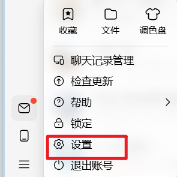
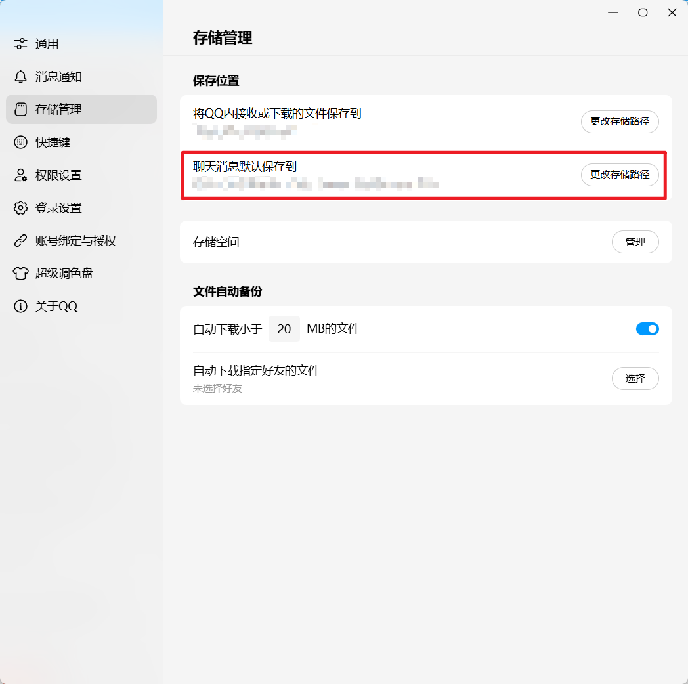

<div align="center">

# CHAOS

**从混乱中，明确下一步。**

以业务线组织工作，让计划、行动与真实投入各归其位。

[界面预览](#界面预览) · [快速开始](#快速开始) · [跟着做一次](#跟着做一次) · [使用指南](docs/product/usage.md)

</div>

事情很多时，难的往往是确定：**今天该做什么，下一步推进什么，哪些事情可以结束。**

CHAOS 是一个本地运行的个人工作台。把外部要求与自己的探索放进几条独立的业务线，沿着节点推进 TODO 与 IDEA；当天做过的事单独记录，会议纪要、批注和探索结论沉淀到 Notes。

工作可以收敛，想法可以长成新的业务线。你的内容始终保存在普通 Markdown 目录里，无需安装 Obsidian。

| 看清下一步                             | 记下真实投入                             | 留下有用的经验                                   |
| :------------------------------------- | :--------------------------------------- | :----------------------------------------------- |
| 业务线横向推进，截止节点与行动一眼可见 | 计划与实际分开，一段工作可以关联多个事项 | 纪要与批注汇入业务线 Notes，随时用 Markdown 阅读 |

## 界面预览

### 工作空间 · 把一堆任务，理成几条清晰的线

项目下维护独立业务线，节点承接要求，TODO／IDEA 承接下一步。还没安排的内容先放在末端待办池。


### 今日 · 知道要做什么，也看见做了什么

当天待办与联络对象集中在左侧；右侧记录真实工作、关联事项，对照计划与实际投入。


### 暖绿 / 静蓝 · 给内容留出空间

两套低饱和主题，在顶部齿轮「备份」中切换。重要性的五档颜色保持相同含义。


> 想录制产品演示动图？见[演示录制指南](docs/development/recording.md)，包含 ScreenToGif 步骤、推荐参数与演示脚本。

## 快速开始

需要 **Windows · Node.js ≥ 22.12 · 本地 NTFS 目录 · Chrome / Edge**。

日常使用可直接双击项目根目录中的 `start-chaos.cmd`。脚本会在缺少依赖时自动安装，每次启动前构建当前代码，待服务就绪后打开浏览器；若服务已经运行，则直接打开页面。首次安装需要联网。使用期间保留启动窗口，按 `Ctrl+C` 停止服务。也可以为此文件创建桌面快捷方式。

如果希望手动启动：

```powershell
npm ci
npm run build
npm start
```

打开 [http://127.0.0.1:4317](http://127.0.0.1:4317)，选择一个 Markdown 工作目录。按 `Ctrl+C` 停止服务。

想先试试看？向一个**空目录**生成当天的示例数据，再在页面中连接该目录：

```powershell
npx tsx scripts/sample-vault.ts E:\CHAOS-Demo
```

也可使用仓库中的 `examples/workspace-vault`，其中日期为固定示例日期。

## 跟着做一次

以「论文研究 → 新方法验证 → 实验方案初稿」为例，跟着真实界面动图，从安排下一步走到记录专注成果。动图循环播放，可点击放大查看。

### 1. 新建业务线

在项目旁添加「新方法验证」，自动获得待办池和专属 Notes。


### 2. 新建节点，再设置待办

添加「实验方案初稿」节点，设定截止点，再把下一步拆成两个 TODO。


### 3. 记录一次专注工作，关联节点并完成待办

记录 14:00–15:30 的真实工作，在待选池中「加入」节点和 TODO，写下成果，勾选「本次完成」并保存。动图最后展示实际时间线与节点完成效果。


> 关联表示这段工作推进了什么；「本次完成」表示哪些行动确实做完了。一段时间关联多个事项仍只统计一次。

### 4. 在 Notes 中看到这次工作的成果

打开「知识」，选择业务线，就能读到该节点下的成果批注和下一步。


## 各页面怎么配合

## 从这里开始使用

| 页面         | 用它做什么                                                 |
| :----------- | :--------------------------------------------------------- |
| **工作空间** | 安排项目、业务线、截止节点与下一步行动                     |
| **今日**     | 看当天计划、处理待办、联系他人、记录实际工作与快速收集想法 |
| **知识**     | 按业务线阅读 Notes，回看纪要、批注与探索结论               |
| **回顾**     | 汇总实际投入与完成情况，记录成果、体会和后续方向           |

条目只有完成与未完成；项目与业务线由你明确结束。无需维护复杂状态，也不发展无限嵌套的任务树。

## 数据属于你

普通 Markdown 工作目录是唯一权威数据源。保留用户正文与外部编辑，遇到冲突停止覆盖；备份由你手动创建，最多保留三份。删除工作对象会保留真实投入与 Notes 正文。

详细规则与限制见[使用指南](docs/product/usage.md)和[数据与安全](docs/architecture/data-and-safety.md)。

## 接入 QQ 与 AI

### 一键接入 QQ（推荐）

需要 **Windows、Node.js ≥ 22.12、Python 3.10+、已安装的 QQNT**。没有 Python 时，脚本会先尝试 winget，失败后再下载官方 Python 3.12 安装程序并安装到当前用户。QQ 不需要提前登录，脚本会负责关闭并以调试模式重新启动它。

1. 关闭正在运行的 CHAOS 和 QQ；
2. 双击项目根目录的 `setup-qq.cmd`；
3. 脚本会检查 Node/Python，缺少 `sqlcipher3` 时自动安装；
4. 脚本会定位 QQ 数据目录、下载并校验密钥提取脚本，然后启动 QQ；
5. 在弹出的 QQ 窗口登录目标账号，脚本会自动捕获密钥；
6. 脚本验证 `nt_msg.db` 可读后，把 QQ 配置写入本机 `%APPDATA%\CHAOS\settings.json`。

脚本不会把密钥打印到控制台。它会收集登录过程中出现的多个候选密钥，并逐个用 `nt_msg.db` 实际解密验证；只有验证通过的密钥才会写入配置。已配置过 QQ 的机器再次运行时通常不需要重新提取。自动同步默认保持关闭，确认测试通过后再启用。如果自动定位账号目录失败，可以指定：

```powershell
.\setup-qq.cmd -DataDir "D:\...\123456789\nt_qq" -SelfQQ "123456789"
```

这里-DataDir是QQ保存文件的路径，可以在QQ的设置中查看。具体操作如下：

点击QQ左下角的三横线，点击设置



进入设置，点击“储存管理”，“将聊天消息默认保存到”下方的路径即为QQ文件的保存目录，其中就包括需要用的数据库，在这个路径后面加上“\123456789\nt_qq”，即为-DataDir需要指定的路径，其中“123456789”为你的QQ号，需要进行替换



密钥提取依赖第三方调试脚本，可能触发安全软件或 QQ 安全提示；仅建议在自己的账号和电脑上使用，QQ 升级后可能需要重新提取。

如果自动下载不方便，也可以手动下载 [QQBackup/qq-win-db-key](https://github.com/QQBackup/qq-win-db-key) 的 `windows_ntqq_get_key.ps1`，然后运行：

```powershell
.\scripts\setup-qq.ps1 -QqKeyExtractorPath "路径\windows_ntqq_get_key.ps1"
```

### 设置 QQ 同步

打开顶部「QQ同步设置」→「QQ自动同步全局设置」：

1. 确认 QQ 数据目录、本人 QQ 号、Python 命令和数据库密钥；
2. 点「测试读取」，能看到群消息/私聊数量即表示数据库可读；
3. 勾选「启用后台自动同步」并保存全局设置；
4. 打开「会话规则设置」，先点「读取 QQ 列表」，会同时读取群和联系人；
5. 在「群聊设置」或「私聊设置」中点击「添加群聊规则」或「添加私聊规则」：
   - 会话类型选「群聊」或「个人聊天」；
   - 群聊按群名或群号搜索；私聊按联系人的原名、备注或 QQ 号搜索，也可直接输入 QQ 号；
   - 设置检查范围、项目/业务线、本人消息和自动加入选项；
   - 保存此规则或保存所有规则。私聊规则默认不启用，需要确认本人 QQ 号后手动勾选。每条规则标题右侧可以“收拢详细／展开详细”，方便在长列表中定位。

只有已启用并绑定群号或私聊 QQ 号的规则才会自动读取；私聊自动同步要求填写本人 QQ 号。首次同步按设置回填最近 7 天；QQ 重新登录后补下来的离线消息会保留原发送时间。

私聊按每条消息独立处理，连续发送多条可能生成多张待确认或重复处理；不建议用于正常聊天，更适合给自己或大小号快速记事项。需要补取某段时间的历史消息时，使用「QQ手动同步」：选择会话和时间段，可决定是否包含本人消息、是否重新分析已同步消息、是否自动加入计划。

### 接入 AI

打开「QQ同步设置」→「模型设置」：

- **DeepSeek**：默认 `https://api.deepseek.com` / `deepseek-flash`；
- **OpenAI / ChatGPT**：填写你的接口地址和可用模型；
- **自定义**：任意 OpenAI 兼容的 `/chat/completions` 地址。

填写 API Key 后保存。配置可切换提供商，各提供商的密钥分别保存，保存一次后重启程序无需重输。

没有可用 API Key 时：

- 「使用 AI 辅助日程添加」会自动取消并置灰；
- 消息按规则过滤后原样进入待确认；
- 可以用「快速处理」的本地解析提取日期、时刻和标签；
- 「用 AI 识别」按钮也会禁用。

配置 API 后，手动重新勾选规则/手动同步里的 AI 开关即可。

### 配置与隐私

- 本机配置：`%APPDATA%\CHAOS\settings.json`（AI Key、QQ 号、QQ 数据库密钥、数据目录）；
- QQ 同步缓存：`%LOCALAPPDATA%\CHAOS\qq-cache`（剥头后的 SQLCipher 副本）；
- Vault 内的规则与待确认：`<Vault>\.atlas\qq-inbox.md`（不含 API Key 或 QQ 数据库密钥）。

API Key 和 QQ 数据库密钥在本机 JSON 中以明文保存，依靠 Windows 用户目录权限保护；不会写入 Markdown 工作目录，也不会进入 Git。不要把配置目录、`.test-vault` 或真实 Vault 提交到仓库。

手动准备依赖时：

```powershell
py -3.12 -m pip install sqlcipher3
```

Python 3.10+ 均可；确保安装 `sqlcipher3` 的解释器与「Python 命令」一致。

## 开发与文档

消息转计划的试用入口为顶部“QQ同步设置”，支持 QQ 会话规则、粘贴消息交给 AI 识别、按会话默认或 AI 自动命名归属、确认后加入业务线。已支持本机 QQNT 数据库的群聊和私聊自动同步：绑定 QQ 群或私聊联系人后定时读取新消息，登录后补下来的离线消息也会按原始时间进入识别；需要一次性提取数据库密钥并安装 Python `sqlcipher3`。每条规则可选择是否“自动加入计划”和“同步本人发送的消息”，默认仍需人工确认且排除本人消息；另提供“QQ手动同步”，按会话和时间段补取群聊或私聊，并可选择重新分析已同步过的消息。AI 会为节点选择会议／报告等标签，有地点信息时写入节点内容。“微信同步设置”中已放置“微信手动同步”和“会话与识别设置”占位，尚未接入微信数据源。会话可以只限定项目，让 AI 只在该项目下匹配或新建业务线；识别模型可选 DeepSeek、OpenAI / ChatGPT 或自定义 OpenAI 兼容接口，设置与各提供商密钥保存在本机配置目录，重启后无需重输。详见[功能边界与使用说明](docs/product/qq-message-intake.md)。

开发运行 `npm run dev`；验证使用 `npm test`、`npm run build`、`npm run test:e2e`。Windows 首次接入 QQ 的完整步骤见上文[接入 QQ 与 AI](#接入-qq-与-ai)。文件测试需要 NTFS 硬链接与 Junction 权限。

- [开发与故障处理](docs/development/guide.md)
- [演示录制指南](docs/development/recording.md)
- [一周试用场景](docs/product/one-week-trial.md)
- [产品与架构原则](AGENTS.md)

采用 [MIT License](LICENSE)。
