<div align="center">


# CHAOS

**从混乱中，明确下一步。**

以业务线组织工作，让计划、行动与真实投入各归其位。

[下载 Windows 桌面版](https://github.com/weiraemon/TRACE_WorkLifeBalance/releases/latest) · [界面预览](#界面预览) · [快速开始](#快速开始) · [跟着做一次](#跟着做一次) · [使用指南](docs/product/usage.md)

</div>

事情很多时，难的往往是确定：**今天该做什么，下一步推进什么，哪些事情可以结束。**

CHAOS 是一个本地运行的个人工作台。把外部要求与自己的探索放进几条独立的业务线，沿着节点推进 TODO 与 IDEA；当天做过的事单独记录，会议纪要、批注和探索结论沉淀到 Notes。

工作可以收敛，想法可以长成新的业务线。你的内容始终保存在普通 Markdown 目录里，无需安装 Obsidian。

| 看清下一步                             | 记下真实投入                             | 留下有用的经验                                   |
| :------------------------------------- | :--------------------------------------- | :----------------------------------------------- |
| 业务线横向推进，截止节点与行动一眼可见 | 计划与实际分开，一段工作可以关联多个事项 | 纪要与批注汇入业务线 Notes，随时用 Markdown 阅读 |

## 界面预览

### 工作空间 · 把一堆任务，理成几条清晰的线

项目下维护独立业务线，节点承接要求，TODO／IDEA 承接下一步。还没安排的内容先放在末端待办池。

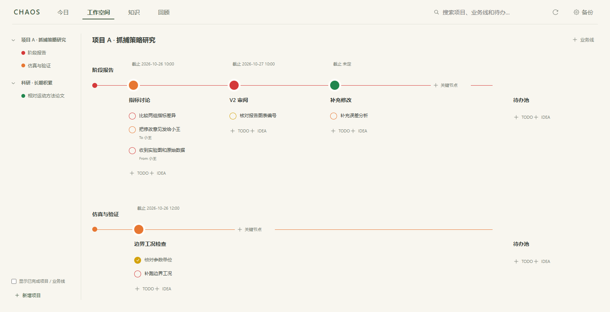

### 今日 · 知道要做什么，也看见做了什么

侧栏查看联络清单和已记录工作，中间按时刻和重要性查看当天安排；右侧用“今日已做 / 待办·节点”切换录入，草稿随切换保留。计划与实际时间线移至回顾，只读查看。

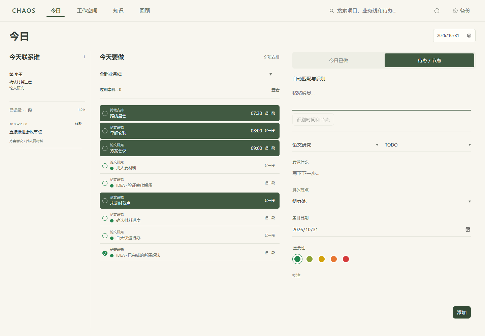

### 回顾 · 看清时间花在哪里

按周查看投入与完成情况，按天回看完整实际记录和只读时间线；记录旁的“修改”入口可更正日期、时间与内容。

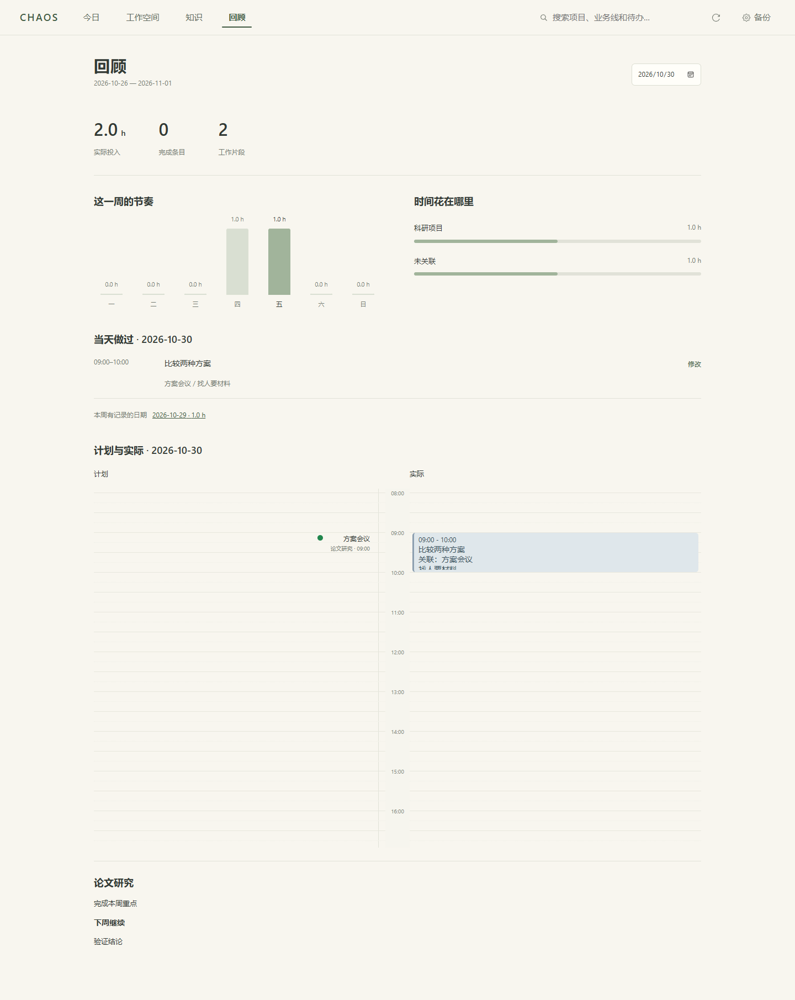

### 暖绿 / 静蓝 · 给内容留出空间

两套低饱和主题，在顶部齿轮「设置」中切换。重要性的五档颜色保持相同含义。

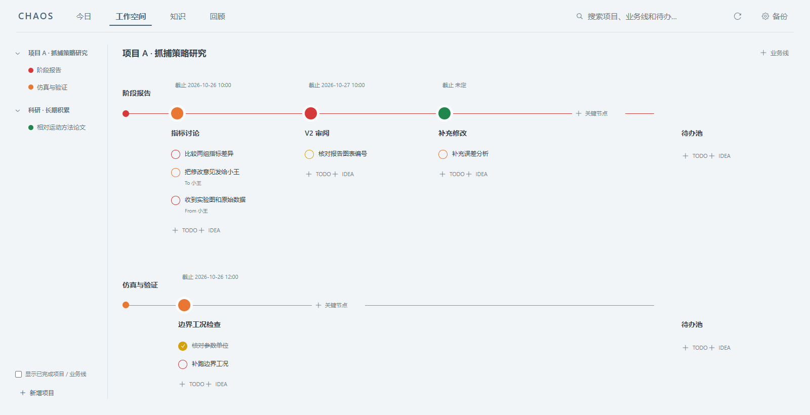

> 想录制产品演示动图？见[演示录制指南](docs/development/recording.md)，包含 ScreenToGif 步骤、推荐参数与演示脚本。

## 快速开始

Android 本地开发版使用六入口竖屏界面，支持本机 Markdown 目录、Wi-Fi 直连与 JSON 增量交换，暂不接入消息与后台自动同步。构建 APK：`npm run package:android`；电脑手机界面预览：`npm run preview:android`，或用 `npm run package:android:preview` 生成可直接安装的手机界面预览 EXE；启动 Android Studio 模拟器后运行 `npm run test:android` 可验收真实 APK、系统目录授权与文件恢复。详见 [Android 构建、预览与验收](docs/development/android-local.md)。

桌面版需要 **Windows x64 · 本地 NTFS 目录**。

**给普通用户：Electron 桌面版**。解压发布包的整个文件夹，双击 `CHAOS.exe`，点击“浏览文件夹…”选择 Markdown 工作目录。自带 Chromium、Node、Python 和 SQLCipher，无需安装浏览器或运行环境，也无需保留终端。关闭程序会同时停止本地服务和 QQ 自动同步；再次启动自动恢复工作目录。可为 `CHAOS.exe` 创建桌面快捷方式。

桌面版保留工作空间、今日、知识、回顾、Notes、备份、资源打开、QQ 和 AI 全部现有能力。QQ 初始化入口在“设置 → QQ同步设置 → QQ自动同步全局设置”；运行环境已内置，可自动检测本机 QQ 数据目录并选择账号，初始化成功后自动刷新配置。仍需安装并使用本人的 QQ，使用 AI 识别时另行配置 API 密钥。微信数据源继续保留现有占位入口。

维护者在 Windows x64 上运行 `npm ci`、`npm run package:desktop`，即可在 `releases/` 得到桌面 ZIP 和 SHA-256 校验文件。Electron 的 npm 包由 `npm ci` 安装；运行文件可能在首次使用时下载。打包复用已完整安装的运行时，无需手动准备 Electron ZIP；首次构建仍需下载经过 SHA-256 校验的 Python／SQLCipher。打包成功后自动清理旧产物，本地只保留最新一份；该目录由 Git 忽略。发布时推送与 `package.json` 版本一致的 `v版本号` tag，GitHub Actions 解压并测试实际发布 ZIP 后，将 ZIP 和校验文件上传到对应 GitHub Release。包不带个人工作目录、目录配置或 QQ／AI 密钥。升级前退出旧服务，再解压新版运行；桌面配置保存在 `%APPDATA%\CHAOS`，升级不必重配。

如果打包出现 `Downloading Electron binary...` 后 `fetch failed`，说明 Electron 运行文件缺失且下载失败。可在 PowerShell 中使用镜像恢复（仍使用 Electron 包自带的官方校验值）：

```powershell
$env:ELECTRON_MIRROR = 'https://npmmirror.com/mirrors/electron/'
node node_modules/electron/install.js
npm run package:desktop
```

该环境变量仅对当前终端有效；无需删除整个 `node_modules`。重新运行 `npm ci` 后，运行文件可能需要从缓存恢复或重新下载。


源码网页版需要 **Node.js ≥ 22.12 · Chrome / Edge**。可双击项目根目录的 `start-chaos.cmd`，或使用下方命令。脚本在缺少依赖时安装，构建当前代码后打开页面；首次安装需要联网。源码启动期间保留终端，按 `Ctrl+C` 停止服务。

页面打开期间会自动重读工作目录，跨天切换到新的今日安排；电脑唤醒或重新激活窗口时立即校准日期并同步。手动查看历史日期时保留选择。空白实际记录表单的默认时间随当前时间更新；开始填写后保留日期、时间和正文，跨天草稿提示历史日期并允许更正，保存或清空后开始新一天的记录。

如果希望手动启动：

```powershell
npm ci
npm run build
npm start
```

打开 [http://127.0.0.1:4317](http://127.0.0.1:4317)，选择一个 Markdown 工作目录。按 `Ctrl+C` 停止服务。

工作目录只需选择一次：桌面版将地址保存到 `%APPDATA%\CHAOS\workspace.json`，源码网页版保存在项目根目录的 `.chaos.local.json`，下次启动自动恢复；也可在「设置」中切换目录。每位用户保留自己的配置。异常关机留下的进程锁会在确认旧进程已退出后自动回收，正常运行的服务仍受到锁保护。

软件包不携带用户工作内容或本机配置。换一个 EXE 或重新解压仍会读取这台电脑记住的目录路径；真正没有本机目录配置的首次启动会要求选择文件夹。工作正文始终保存在用户选定的 Markdown 目录中。

想先试试看？向一个**空目录**生成当天的示例数据，再在页面中连接该目录：

```powershell
npx tsx scripts/sample-vault.ts E:\CHAOS-Demo
```

也可使用仓库中的 `examples/workspace-vault`，其中日期为固定示例日期。

## 跟着做一次

以「论文研究 → 新方法验证 → 实验方案初稿」为例，跟着真实界面动图，从安排下一步走到记录专注成果。动图循环播放，可点击放大查看。

### 1. 新建业务线

在项目旁添加「新方法验证」，自动获得待办池和专属 Notes。

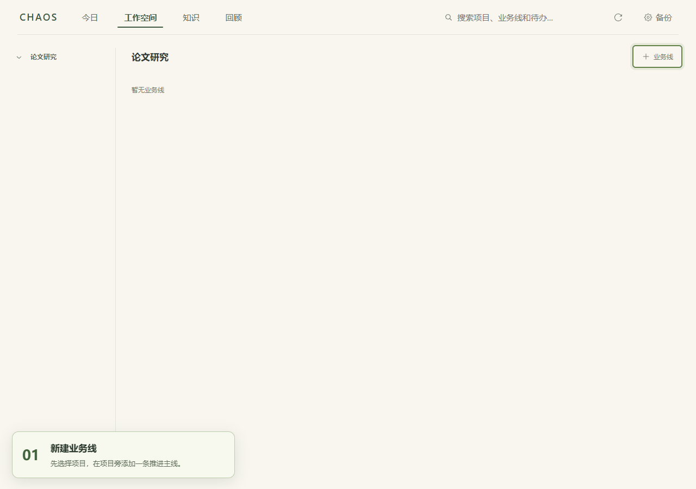

### 2. 新建节点，再设置待办

添加「实验方案初稿」节点，设定截止点，再把下一步拆成两个 TODO。

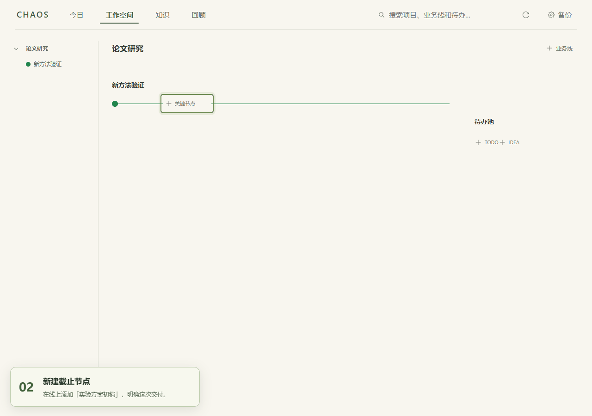

### 3. 记录一次专注工作，关联节点并完成待办

记录 14:00–15:30 的真实工作，在待选池中「加入」节点和 TODO，写下成果，勾选「本次完成」并保存。保存后可在回顾的只读时间线查看投入，并在工作空间查看节点完成效果。

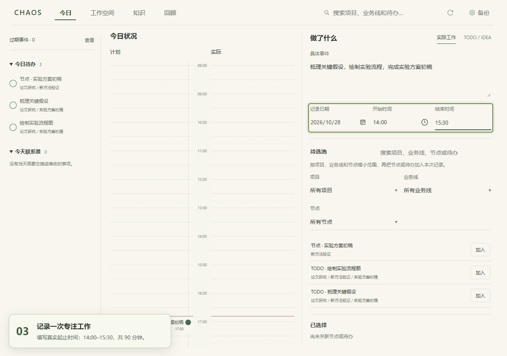

> 关联表示这段工作推进了什么；「本次完成」表示哪些行动确实做完了。一段时间关联多个事项仍只统计一次。

### 4. 在 Notes 中看到这次工作的成果

打开「知识」，选择业务线，就能读到该节点下的成果批注和下一步。

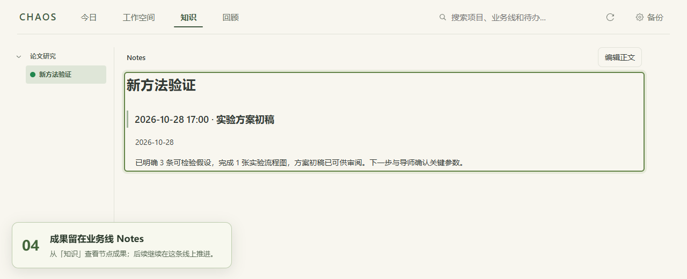

## 各页面怎么配合

## 从这里开始使用

| 页面         | 用它做什么                                                 |
| :----------- | :--------------------------------------------------------- |
| **工作空间** | 安排项目、业务线、截止节点与下一步行动                     |
| **今日**     | 看当天计划、处理待办、联系他人、记录实际工作与快速收集想法 |
| **知识**     | 按业务线阅读 Notes，回看纪要、批注与探索结论               |
| **回顾**     | 汇总实际投入与完成情况，记录成果、体会和后续方向           |

条目只有完成与未完成；项目与业务线由你明确结束。无需维护复杂状态，也不发展无限嵌套的任务树。

## 数据属于你

普通 Markdown 工作目录是唯一权威数据源。保留用户正文与外部编辑，遇到冲突停止覆盖；备份由你手动创建，最多保留三份。删除工作对象会保留真实投入与 Notes 正文。

详细规则与限制见[使用指南](docs/product/usage.md)和[数据与安全](docs/architecture/data-and-safety.md)。

## 接入 QQ 与 AI

### 接入 QQ（Windows 桌面版，推荐）

使用最新版 `CHAOS.exe`，并在本机安装 QQNT。**桌面版已内置 Node.js、Python 和 SQLCipher，无需另外安装。** 请先在 QQ 中登录一次需要接入的本人账号，让本机生成该账号的数据目录。

1. 打开 CHAOS，连接工作目录，点击右上角齿轮「设置」。

   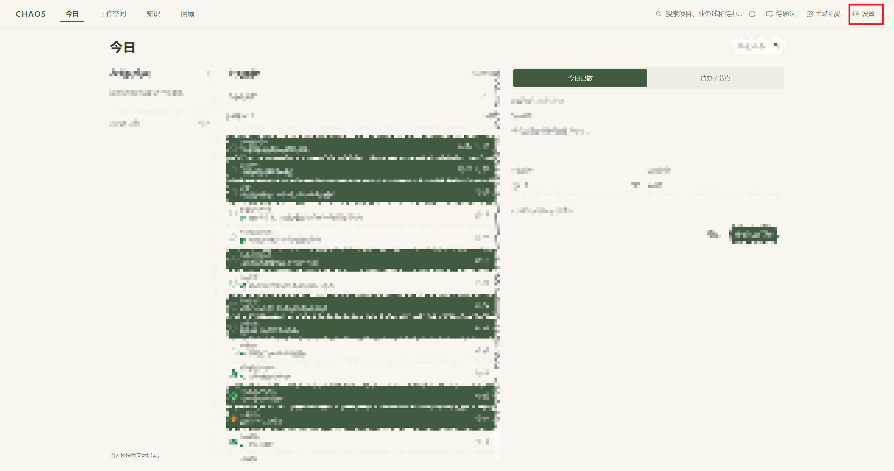

2. 点击「QQ同步设置」，进入「QQ自动同步全局设置」。

   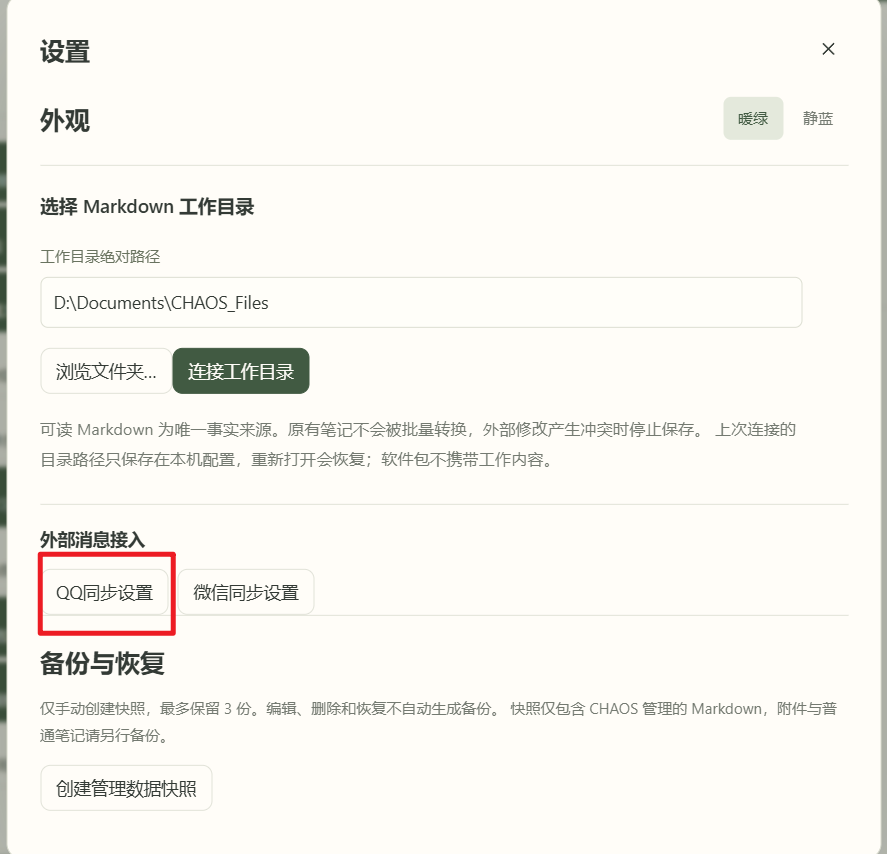

3. 点击「初始化 QQ 数据库读取…」，程序会自动检查已保存的目录和本机常见 QQ 数据位置。

   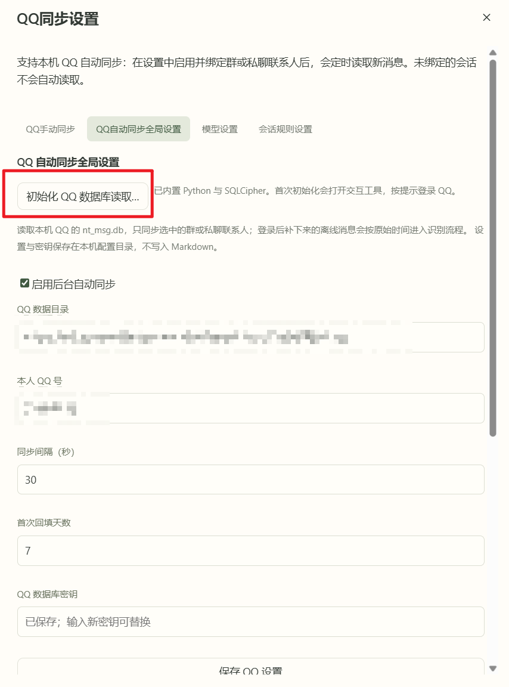

4. 在弹窗中选择本人 QQ 账号。只检测到一个账号时会自动预选；检测到多个账号时需要手动选择。列表显示 QQ 号、数据库最近更新时间和目录，通常无需输入路径或 QQ 号。最近更新时间仅供辨认，不表示该账号当前已登录。

   

5. 如果没有找到账号，点击「选择文件夹查找…」。选择 QQ 数据所在的文件夹或其上级目录，例如 `Tencent Files` 或 `D:\qq_files`，程序会继续查找并识别账号，**不必手动找到 nt_qq 或 nt_db，也不必拼接 QQ 号路径**。搜索达到范围上限时，按提示选择更接近账号数据的文件夹再试。

   不清楚 QQ 的存储位置时，可以到 QQ 的「设置 → 存储管理」查看聊天消息保存位置，再在 CHAOS 中选择对应文件夹。不同 QQ 版本的菜单名称可能略有差异。

   
   

6. 确认所选账号后，点击「启动初始化工具」，按弹出的命令行提示继续。已有密钥仍然有效时会直接复用；需要重新获取时，工具会关闭并重新启动 QQ，请登录**刚刚选择的账号**。CHAOS 弹窗会显示等待提示。

7. 看到「初始化完成」后，CHAOS 会**自动刷新 QQ 配置**，无需手动重新加载。命令行窗口会保留，并提示「初始化程序已执行完毕，可以手动关闭此窗口」，此时可以关闭。若工具关闭了 QQ，请重新打开并保持登录。初始化失败或提前关窗时，按界面提示检查原因并重试。

初始化完成后，按下方「设置 QQ 同步」选择需要读取的群聊或私聊并启用同步。数据库密钥由工具验证后保存到本机配置，无需手工复制粘贴；QQ 升级后若读取失效，可重新初始化。

源码网页版用户可运行项目根目录的 `setup-qq.cmd` 完成初始化；需要 Node.js ≥ 22.12 和 Python 3.10–3.12（推荐 3.12），脚本会检查依赖并尝试补齐。上述自动检测和账号选择弹窗属于 Windows 桌面版。

### 设置 QQ 同步

打开齿轮「设置」内的「QQ同步设置」→「QQ自动同步全局设置」：

1. 确认初始化后自动填入的 QQ 数据目录、本人 QQ 号及密钥已保存状态；桌面版无需填写 Python 命令；
2. 点「测试读取」，能看到群消息/私聊数量即表示数据库可读；
3. 勾选「启用后台自动同步」，点击「保存 QQ 设置」；
4. 打开「会话规则设置」，先点「读取 QQ 列表」，会同时读取群和联系人；
5. 在「群聊设置」或「私聊设置」中点击「添加群聊规则」或「添加私聊规则」：
   - 会话类型选「群聊」或「个人聊天」；
   - 群聊按群名或群号搜索；私聊按联系人的原名、备注或 QQ 号搜索，也可直接输入 QQ 号；
   - 设置检查范围、项目/业务线、本人消息和自动加入选项；
   - 保存此规则或保存所有规则。私聊规则默认不启用，需要确认本人 QQ 号后手动勾选。每条规则标题右侧可以“收拢详细／展开详细”，方便在长列表中定位。

只有已启用并绑定群号或私聊 QQ 号的规则才会自动读取；私聊自动同步要求填写本人 QQ 号。首次同步按设置回填最近 7 天；QQ 重新登录后补下来的离线消息会保留原发送时间。

私聊按每条消息独立处理，连续发送多条可能生成多张待确认或重复处理；不建议用于正常聊天，更适合给自己或大小号快速记事项。需要补取某段时间的历史消息时，使用「QQ手动同步」：选择会话和时间段，可决定是否包含本人消息、是否重新分析已同步消息、是否自动加入计划。

### 接入 AI

打开「QQ同步设置」→「模型设置」：

- **DeepSeek**：默认 `https://api.deepseek.com` / `deepseek-flash`；
- **OpenAI / ChatGPT**：填写你的接口地址和可用模型；
- **自定义**：任意 OpenAI 兼容的 `/chat/completions` 地址。

填写 API Key 后保存。配置可切换提供商，各提供商的密钥分别保存，保存一次后重启程序无需重输。

没有可用 API Key 时：

- 「使用 AI 辅助日程添加」会自动取消并置灰；
- 消息按规则过滤后原样进入待确认；
- 可以用「快速处理」的本地解析提取日期、时刻和标签；
- 「用 AI 识别」按钮也会禁用。

配置 API 后，手动重新勾选规则/手动同步里的 AI 开关即可。

### 配置与隐私

- 本机配置：`%APPDATA%\CHAOS\settings.json`（AI Key、QQ 号、QQ 数据库密钥、数据目录）；
- QQ 同步缓存：`%LOCALAPPDATA%\CHAOS\qq-cache`（剥头后的 SQLCipher 副本）；
- Vault 内的规则与待确认：`<Vault>\.atlas\qq-inbox.md`（不含 API Key 或 QQ 数据库密钥）。

API Key 和 QQ 数据库密钥在本机 JSON 中以明文保存，依靠 Windows 用户目录权限保护；不会写入 Markdown 工作目录，也不会进入 Git。不要把配置目录、`.test-vault` 或真实 Vault 提交到仓库。

仅源码运行需要手动准备 Python 依赖时（桌面版无需执行）：

```powershell
py -3.12 -m pip install sqlcipher3
```

Python 3.10–3.12 最稳妥，推荐 3.12；3.13+ 如果没有 `sqlcipher3` 预编译包，pip 会尝试源码编译并要求 Visual C++ Build Tools。确保安装 `sqlcipher3` 的解释器与「Python 命令」一致；初始化脚本会优先使用 3.12。

## 开发与文档

消息转计划的试用入口为顶部「待确认」和「手动粘贴」，QQ 同步设置在齿轮「设置」内。待确认窗口分为「QQ消息」和「微信消息」，支持 QQ 会话规则、按会话默认或 AI 自动命名归属、确认后加入业务线；手动粘贴单独用于把一段 QQ 文本交给 AI 识别。已支持本机 QQNT 数据库的群聊和私聊自动同步：绑定 QQ 群或私聊联系人后定时读取新消息，登录后补下来的离线消息也会按原始时间进入识别；需要完成一次 QQ 初始化；桌面版已内置 Python 和 `sqlcipher3`。每条规则可选择是否“自动加入计划”和“同步本人发送的消息”，默认仍需人工确认且排除本人消息；另提供“QQ手动同步”，按会话和时间段补取群聊或私聊，并可选择重新分析已同步过的消息。AI 会为节点选择会议／报告等标签，有地点信息时写入节点内容。「微信消息」目前为待确认占位，尚未接入微信数据源。会话可以只限定项目，让 AI 只在该项目下匹配或新建业务线；识别模型可选 DeepSeek、OpenAI / ChatGPT 或自定义 OpenAI 兼容接口，设置与各提供商密钥保存在本机配置目录，重启后无需重输。详见[功能边界与使用说明](docs/product/qq-message-intake.md)。

开发运行 `npm run dev`；验证使用 `npm test`、`npm run build`、`npm run test:e2e`。Windows 首次接入 QQ 的完整步骤见上文[接入 QQ 与 AI](#接入-qq-与-ai)。文件测试需要 NTFS 硬链接与 Junction 权限。

- [开发与故障处理](docs/development/guide.md)
- [Android 开发原则与实施方法](docs/development/android-development.md)
- [仓库分工与跨端复用](docs/architecture/repository.md)
- [演示录制指南](docs/development/recording.md)
- [一周试用场景](docs/product/one-week-trial.md)
- [产品与架构原则](AGENTS.md)

采用 [MIT License](LICENSE)。

外部客户端和后续平台接入可使用[标准业务 API 与扩展约定](docs/architecture/business-api.md)，复用现有业务规则；不会为每个接入重建工作页面。
