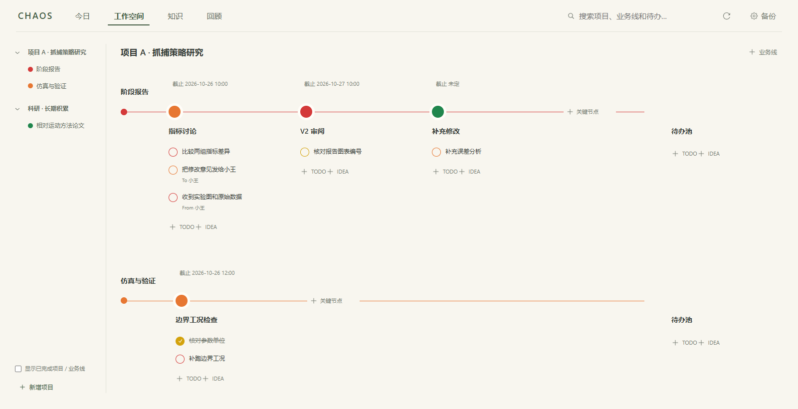
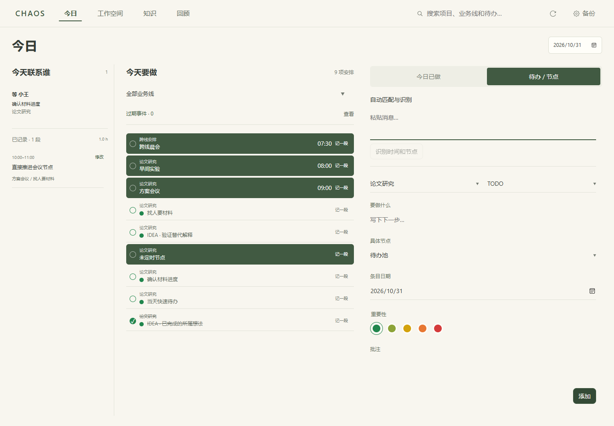
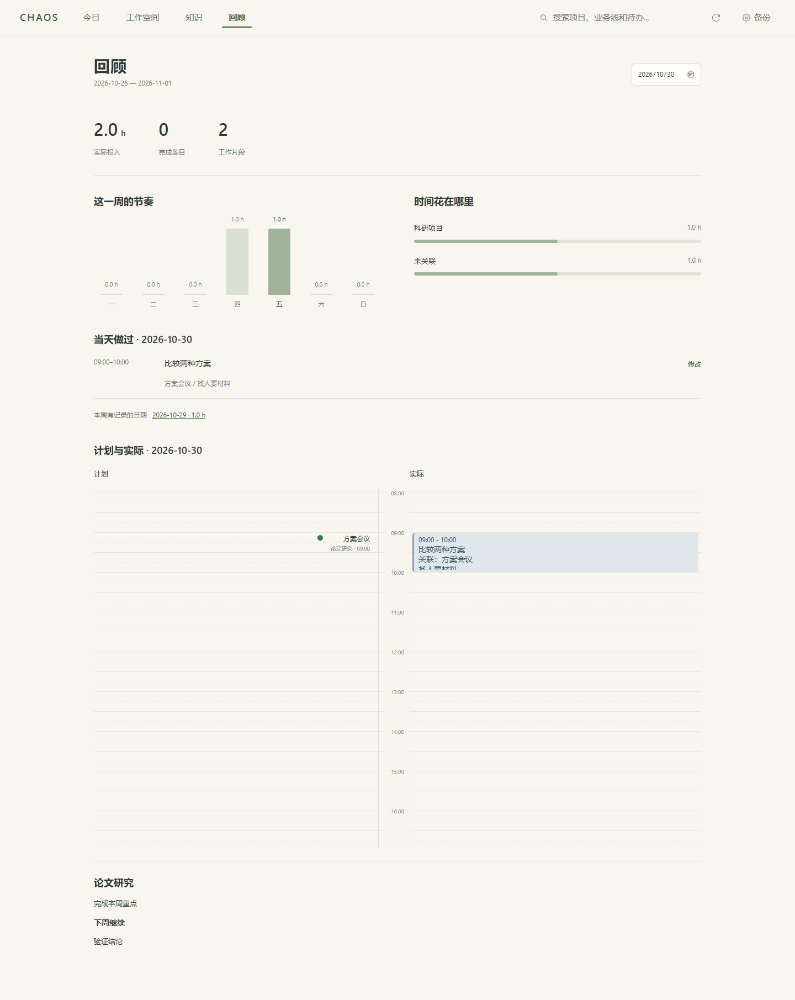
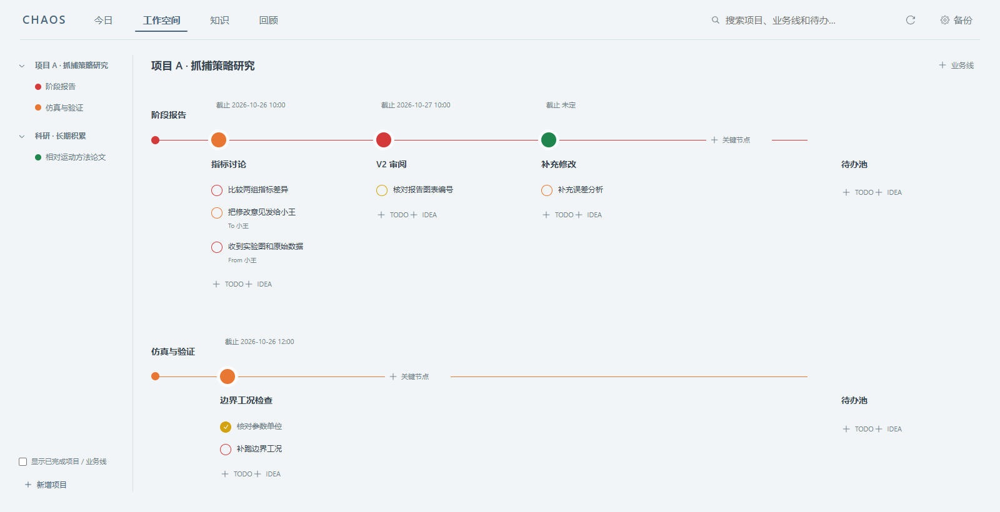
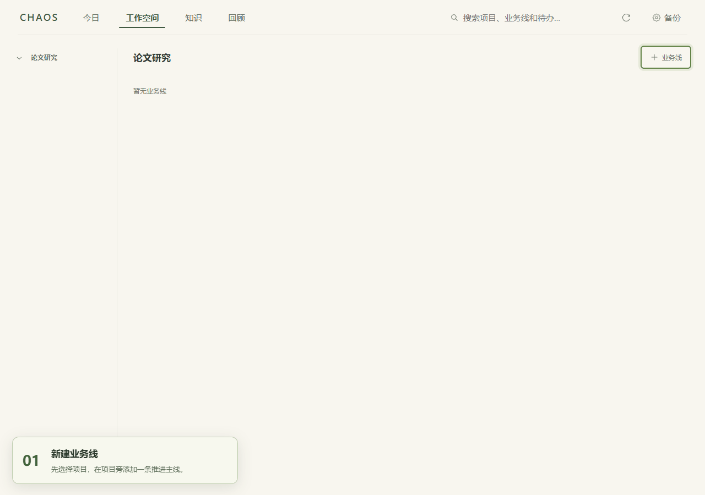
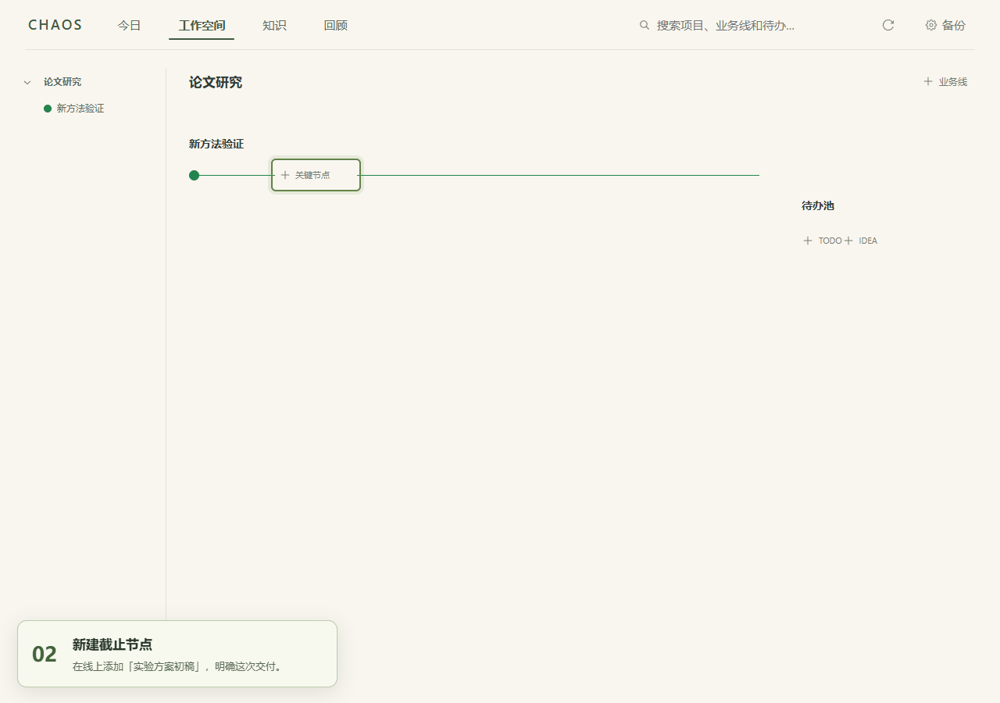
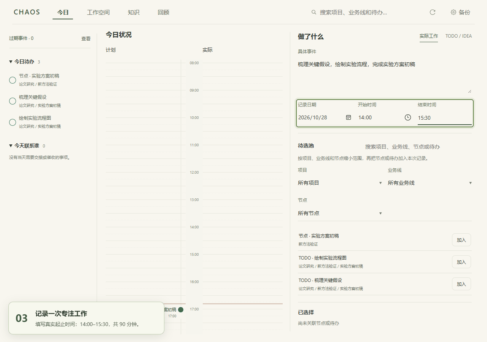
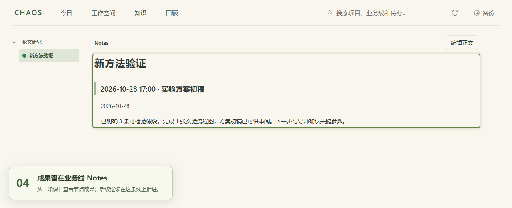

<div align="center">

# CHAOS

**从混乱中，明确下一步。**

以业务线组织工作，让计划、行动与真实投入各归其位。

[界面预览](#界面预览) · [快速开始](#快速开始) · [跟着做一次](#跟着做一次) · [使用指南](docs/product/usage.md)

</div>

事情很多时，难的往往是确定：**今天该做什么，下一步推进什么，哪些事情可以结束。**

CHAOS 是一个本地运行的个人工作台。把外部要求与自己的探索放进几条独立的业务线，沿着节点推进 TODO 与 IDEA；当天做过的事单独记录，会议纪要、批注和探索结论沉淀到 Notes。

工作可以收敛，想法可以长成新的业务线。你的内容始终保存在普通 Markdown 目录里，无需安装 Obsidian。

| 看清下一步                             | 记下真实投入                             | 留下有用的经验                                   |
| :------------------------------------- | :--------------------------------------- | :----------------------------------------------- |
| 业务线横向推进，截止节点与行动一眼可见 | 计划与实际分开，一段工作可以关联多个事项 | 纪要与批注汇入业务线 Notes，随时用 Markdown 阅读 |

## 界面预览

### 工作空间 · 把一堆任务，理成几条清晰的线

项目下维护独立业务线，节点承接要求，TODO／IDEA 承接下一步。还没安排的内容先放在末端待办池。



### 今日 · 知道要做什么，也看见做了什么

侧栏查看联络清单和已记录工作，中间按时刻和重要性查看当天安排；右侧用“今日已做 / 待办·节点”切换录入，草稿随切换保留。计划与实际时间线移至回顾，只读查看。



### 回顾 · 看清时间花在哪里

按周查看投入与完成情况，按天回看完整实际记录和只读时间线；记录旁的“修改”入口可更正日期、时间与内容。



### 暖绿 / 静蓝 · 给内容留出空间

两套低饱和主题，在顶部齿轮「备份」中切换。重要性的五档颜色保持相同含义。



> 想录制产品演示动图？见[演示录制指南](docs/development/recording.md)，包含 ScreenToGif 步骤、推荐参数与演示脚本。

## 快速开始

需要 **Windows · Node.js ≥ 22.12 · 本地 NTFS 目录 · Chrome / Edge**。

```powershell
npm ci
npm run build
npm start
```

打开 [http://127.0.0.1:4317](http://127.0.0.1:4317)，选择一个 Markdown 工作目录。按 `Ctrl+C` 停止服务。

工作目录只需输入一次：成功连接后，地址会保存到项目根目录的 `.chaos.local.json`，下次启动自动恢复；也可在「备份」中切换目录。该文件已加入 Git 忽略规则，每位用户保留自己的配置。异常关机留下的进程锁会在确认旧进程已退出后自动回收，正常运行的服务仍受到锁保护。

想先试试看？向一个**空目录**生成当天的示例数据，再在页面中连接该目录：

```powershell
npx tsx scripts/sample-vault.ts E:\CHAOS-Demo
```

也可使用仓库中的 `examples/workspace-vault`，其中日期为固定示例日期。

## 跟着做一次

以「论文研究 → 新方法验证 → 实验方案初稿」为例，跟着真实界面动图，从安排下一步走到记录专注成果。动图循环播放，可点击放大查看。

### 1. 新建业务线

在项目旁添加「新方法验证」，自动获得待办池和专属 Notes。



### 2. 新建节点，再设置待办

添加「实验方案初稿」节点，设定截止点，再把下一步拆成两个 TODO。



### 3. 记录一次专注工作，关联节点并完成待办

记录 14:00–15:30 的真实工作，在待选池中「加入」节点和 TODO，写下成果，勾选「本次完成」并保存。保存后可在回顾的只读时间线查看投入，并在工作空间查看节点完成效果。



> 关联表示这段工作推进了什么；「本次完成」表示哪些行动确实做完了。一段时间关联多个事项仍只统计一次。

### 4. 在 Notes 中看到这次工作的成果

打开「知识」，选择业务线，就能读到该节点下的成果批注和下一步。



## 各页面怎么配合

| 页面         | 用它做什么                                                 |
| :----------- | :--------------------------------------------------------- |
| **工作空间** | 安排项目、业务线、截止节点与下一步行动                     |
| **今日**     | 看当天计划、处理待办、联系他人、记录实际工作与快速收集想法 |
| **知识**     | 按业务线阅读 Notes，回看纪要、批注与探索结论               |
| **回顾**     | 汇总实际投入与完成情况，记录成果、体会和后续方向           |

条目只有完成与未完成；项目与业务线由你明确结束。无需维护复杂状态，也不发展无限嵌套的任务树。

## 数据属于你

普通 Markdown 工作目录是唯一权威数据源。保留用户正文与外部编辑，遇到冲突停止覆盖；备份由你手动创建，最多保留三份。删除工作对象会保留真实投入与 Notes 正文。

详细规则与限制见[使用指南](docs/product/usage.md)和[数据与安全](docs/architecture/data-and-safety.md)。

## 开发与文档

开发运行 `npm run dev`；验证使用 `npm test`、`npm run build`、`npm run test:e2e`。文件测试需要 NTFS 硬链接与 Junction 权限。

- [开发与故障处理](docs/development/guide.md)
- [演示录制指南](docs/development/recording.md)
- [一周试用场景](docs/product/one-week-trial.md)
- [产品与架构原则](AGENTS.md)

采用 [MIT License](LICENSE)。
