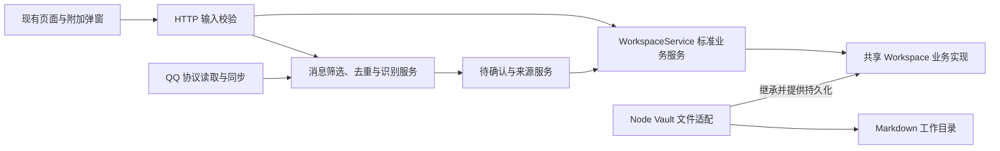

# 标准业务接口与扩展约定

CHAOS 以现有 main 页面和业务规则为准。新增外部能力以弹窗、提示或既有设置的增量内容接入，不重建今日、工作空间、知识、回顾，也不复制新增、编辑或完成流程。

## 依赖方向



- packages/domain/business.ts：版本化命令、计划输入和机器可读 Schema 的唯一来源；不引用 QQ 或 AI 提供商。
- packages/workspace/workspace-service.ts：网页与任意客户端共用的业务入口，不依赖 Node Vault。保存、完成、改期、批注和 Notes 操作复用 packages/workspace/workspace.ts 中的同一份业务规则。
- application/message-intake-service.ts：共用的消息筛选、去重、AI 识别与待确认流程；QQ 和粘贴识别调用同一实现。
- application/message-inbox-service.ts：来源、确认和批量处理。将识别建议转换为标准业务命令，不直接改写工作文件。
- sync/qq-sync.ts：QQ 读取脚本、协议数据转换、同步时间和游标。新增平台也遵守这一边界。
- packages/workspace/markdown.ts 与 line-notes.ts：Markdown 保真处理、Notes 正文组织与迁移，不依赖操作系统。
- native/：Node 文件读写、索引诊断、路径安全、锁、原子发布与恢复；Vault 继承共享 Workspace 实现，不再维护完成、改期和 Notes 业务副本。不得依赖消息模型、QQ 或 AI 接入。

完整目录职责、持久化约束与后续移动端接入方式见[仓库分工与跨端复用](repository.md)。网页和后续客户端统一使用以下标准业务 API，Markdown 数据格式保持不变。

原生保存仅增加供可信服务使用的事务伴随文件；HTTP 命令不能提供文件路径或伴随文件。确认入库时，工作对象、Notes 与待确认状态一起发布，冲突时不部分保存。改期仍遵守 TODO 独立日期超过节点日期时进入待办池的规则；节点完成仍由下属条目推导，关联实际记录不等于完成。

## 本地 HTTP API v1

Android 经 `api.ts` 的平台传输入口在本机调用同一版本的 `WorkspaceService`，命令仍为下表的标准契约，不依赖 Windows HTTP 服务。`apps/android/web` 负责装配；目录选择、备份、导出和资源打开属于受限的平台能力。SAF 原始文件操作只供受信任本地运行时使用，不作为外部业务 API。手机没有另建完成状态、计划副本或同步接口。

服务仍只监听本机，同一会话的网页与客户端共享同一工作目录。没有为第三方放开跨域或跳过身份校验。

| 方法 | 地址                       | 返回                               |
| ---- | -------------------------- | ---------------------------------- |
| GET  | /api/session               | 当前会话 token、vaultId 与连接状态 |
| GET  | /api/business/v1/schema    | version 与命令 JSON Schema         |
| GET  | /api/business/v1/workspace | version 与 snapshot                |
| POST | /api/business/v1/commands  | version 与 result                  |

Android 的写入命令响应可附带 `snapshot`，表示该批文件成功发布后的同一份工作快照。前端只将其交付给紧随写入的一次刷新，后续刷新仍重新读取目录。连续命令按请求顺序丢弃迟到响应，连接或切换目录会使待交付快照失效。发布失败不附带快照，Markdown 内容及 SHA-256 revision 继续作为权威事实。

除 session 外需要 X-Atlas-Token、X-Atlas-Vault；POST 使用 application/json。客户端必须读取最新快照中的 revision，修改前传回该版本。版本过期返回 409，输入不合法返回 400，会话不合法返回 403。JSON Schema 负责描述输入结构，跨对象关系和完成规则仍由服务端校验。

业务接口版本是字符串 1；X-Atlas-Contract 继续负责整套网页／服务兼容校验，当前为 atlas-lines-26。升级后需重启服务并刷新网页。旧的 snapshot、records、content、notes、promote、delete-preview、delete-space 网页路由已移除，不保留兼容转发；读取工作快照和执行工作命令统一走 /api/business/v1。新增 notes.create 承接原有普通 Markdown 笔记创建能力。会话、连接目录、备份、本机打开与消息接入仍使用各自的应用／平台接口。

| 命令 type          | 关键输入                                       | 用途                                                                  |
| ------------------ | ---------------------------------------------- | --------------------------------------------------------------------- |
| record.save        | data、可选 revision / options                  | 创建或编辑项目、业务线、节点、条目及实际记录；结构与现有记录契约一致  |
| actual.delete      | id、revision                                   | 删除一条实际记录，核对当前内容版本，保留已发布的完成事实和 Notes 正文 |
| plan.create        | plan                                           | 原子创建计划、必要项目／业务线、节点、条目及来源 Notes                |
| work.complete      | id、revision、completed                        | 完成或重新打开，节点按既有规则处理下属条目                            |
| work.reschedule    | id、revision、dueDate、可选 dueTime / location | 改期；TODO 不允许独立时刻                                             |
| work.comment       | id、revision、text、可选 date                  | 批注或纪要写入所属 Notes                                              |
| work.promote       | id、revision                                   | 升为独立业务线                                                        |
| work.deletePreview | id                                             | 查看删除范围                                                          |
| work.delete        | id、expectations                               | 按确认过的版本删除                                                    |
| notes.create       | note（title、可选 kind / tag）                 | 创建普通 Markdown 笔记，保留原有文件名与标签校验                      |
| notes.read         | id                                             | 读取同一份 Notes 正文                                                 |
| notes.save         | id、revision、body                             | 保存业务线 Notes 全文                                                 |
| exchange.export    | 可选 baseline（回执）                          | 生成全量首次包或相对于回执的新增／更新增量包                          |
| exchange.preview   | bundle                                         | 验证 JSON 包，匹配 UUID，返回冲突和绑定当前状态的预览版本             |
| exchange.apply     | bundle、revision（预览版本）                   | 整包原子导入并生成确认回执，不直接接受文件变更                        |

JSON 格式、机器可读 Schema、共同版本与冲突语义见[增量交换协议](exchange.md)。Windows 和 Android 调用同一命令，系统文件选择与保存只负责传递 JSON。删除、附件与后台联网不在首版交换范围内。

Wi-Fi 的本机控制接口为 `GET /api/wifi/status`、`POST /api/wifi/start`（host）、`/stop`、`/confirm` 与 `/reject`（packageId）。它们仍需本机 token 和当前目录会话。`/request` 只代理到私有 IPv4 的固定交换路径；Android 的同名平台路由交给受限原生 HTTP 桥。独立局域网端口只接受 AES-GCM 密文，不暴露这些控制接口；收到手机变化只创建内存中的待确认预览，不能远程执行确认。退出或切换目录时关闭会话。

外部客户端可直接创建计划，无需伪装成 QQ 消息：

```json
{
  "type": "plan.create",
  "plan": {
    "kind": "event",
    "title": "方案讨论",
    "lineId": "现有业务线 UUID",
    "dueDate": "2026-11-02",
    "dueTime": "09:00",
    "tags": ["会议"],
    "actions": ["准备材料"]
  }
}
```

plan.kind 支持 task / event；未指定日期时不安排到今天。lineId 可以指定现有业务线；destination 可以选择 existing、newLine 或 newProject，projectId 可限定归属范围。note 可传入唯一 id、text 和 date，将原文写入 Notes，不创建第二份历史档案。

PowerShell 客户端调用示例（先在网页连接目录，UUID 与 revision 取自快照）：

```powershell
$base = 'http://127.0.0.1:4317/api'
$session = Invoke-RestMethod "$base/session"
$headers = @{ 'X-Atlas-Token' = $session.token; 'X-Atlas-Vault' = $session.vaultId }
$workspace = Invoke-RestMethod "$base/business/v1/workspace" -Headers $headers
$command = @{ type = 'work.complete'; id = '对象 UUID'; revision = '快照中的 revision'; completed = $true }
Invoke-RestMethod "$base/business/v1/commands" -Method Post -Headers $headers -ContentType 'application/json' -Body ($command | ConvertTo-Json -Depth 10)
```

## 后续新增功能

1. 先确定能否由现有业务命令表达；能表达时直接复用，不给平台单独复制完成、改期、归属、Notes 或删除逻辑。
2. 协议读取、鉴权密钥、原始消息转换放在接入层。密钥使用本机配置，不进入 Markdown 工作目录、Git 或日志。
3. 消息先经过规则、稳定来源 ID 与内容去重，再进入共用识别服务。默认保留待确认；自动确认仍调用同一业务服务。
4. 新增业务能力时先修改标准契约和服务，提供必要的回归测试，再接网页弹窗和平台适配器。破坏输入或响应兼容性时新增 API 版本。
5. 保持四页导航和现有布局。使用当前表单、设置、附加弹窗与提示承接功能；不增加重复工作面板。
6. 验证原有流程与新增适配器。QQ / AI 使用本地模拟数据和服务测试，未经用户授权不对真实账号读写或发送真实消息。

npm run check:architecture 检查核心层不反向引用接入层，npm run check 包含这一检查及业务、构建和浏览器回归。该检查用于约束依赖，不替代业务测试。

### Windows QQ 初始化桌面契约

- `chaos:discover-qq({ seed?: string, browse?: boolean })`：返回 `{ accounts: [{ dataDir, selfQQ, modified }], limited }`；浏览文件夹取消返回 `null`。仅可信主窗口可调用，扫描有深度、目录数量和时间预算。
- `chaos:setup-qq({ dataDir, selfQQ })`：只在脚本成功验证并写入本机配置后 resolve；失败、提前关闭和超时 reject，禁止并发初始化。主进程生成独立临时结果文件，通过 `-ResultFile` 传给脚本，内容仅为 `success` 或 `failed`，最终清理。命令行保留供用户阅读，不以窗口关闭作为成功依据。
- 前端成功后使用现有消息配置读取接口刷新，不改写业务 Markdown，不增加业务命令。密钥不经过桌面桥接。
