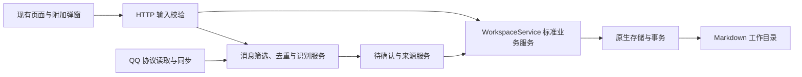

# 标准业务接口与扩展约定

CHAOS 以现有 main 页面和业务规则为准。新增外部能力以弹窗、提示或既有设置的增量内容接入，不重建今日、工作空间、知识、回顾，也不复制新增、编辑或完成流程。

## 依赖方向



- packages/domain/business.ts：版本化命令、计划输入和机器可读 Schema 的唯一来源；不引用 QQ 或 AI 提供商。
- application/workspace-service.ts：网页与任意客户端共用的业务入口。保存、完成、改期、批注和 Notes 操作复用原有原生规则。
- application/message-intake-service.ts：共用的消息筛选、去重、AI 识别与待确认流程；QQ 和粘贴识别调用同一实现。
- application/message-inbox-service.ts：来源、确认和批量处理。将识别建议转换为标准业务命令，不直接改写工作文件。
- sync/qq-sync.ts：QQ 读取脚本、协议数据转换、同步时间和游标。新增平台也遵守这一边界。
- native/：安全文件读写、既有业务校验、Notes 和原子发布。不得依赖消息模型、QQ 或 AI 接入。

原生保存仅增加供可信服务使用的事务伴随文件；HTTP 命令不能提供文件路径或伴随文件。确认入库时，工作对象、Notes 与待确认状态一起发布，冲突时不部分保存。改期仍遵守 TODO 独立日期超过节点日期时进入待办池的规则；节点完成仍由下属条目推导，关联实际记录不等于完成。

## 本地 HTTP API v1

服务仍只监听本机，同一会话的网页与客户端共享同一工作目录。没有为第三方放开跨域或跳过身份校验。

| 方法 | 地址                       | 返回                               |
| ---- | -------------------------- | ---------------------------------- |
| GET  | /api/session               | 当前会话 token、vaultId 与连接状态 |
| GET  | /api/business/v1/schema    | version 与命令 JSON Schema         |
| GET  | /api/business/v1/workspace | version 与 snapshot                |
| POST | /api/business/v1/commands  | version 与 result                  |

除 session 外需要 X-Atlas-Token、X-Atlas-Vault；POST 使用 application/json。客户端必须读取最新快照中的 revision，修改前传回该版本。版本过期返回 409，输入不合法返回 400，会话不合法返回 403。JSON Schema 负责描述输入结构，跨对象关系和完成规则仍由服务端校验。

业务接口版本是字符串 1；X-Atlas-Contract 继续负责整套网页／服务兼容校验。升级本轮代码后需重启服务并刷新网页。旧 /api/records 等网页路由保留原有返回格式，内部共用 WorkspaceService 与原生业务实现。

| 命令 type          | 关键输入                                       | 用途                                                                 |
| ------------------ | ---------------------------------------------- | -------------------------------------------------------------------- |
| record.save        | data、可选 revision / options                  | 创建或编辑项目、业务线、节点、条目及实际记录；结构与现有记录契约一致 |
| plan.create        | plan                                           | 原子创建计划、必要项目／业务线、节点、条目及来源 Notes               |
| work.complete      | id、revision、completed                        | 完成或重新打开，节点按既有规则处理下属条目                           |
| work.reschedule    | id、revision、dueDate、可选 dueTime / location | 改期；TODO 不允许独立时刻                                            |
| work.comment       | id、revision、text、可选 date                  | 批注或纪要写入所属 Notes                                             |
| work.promote       | id、revision                                   | 升为独立业务线                                                       |
| work.deletePreview | id                                             | 查看删除范围                                                         |
| work.delete        | id、expectations                               | 按确认过的版本删除                                                   |
| notes.read         | id                                             | 读取同一份 Notes 正文                                                |
| notes.save         | id、revision、body                             | 保存业务线 Notes 全文                                                |

外部客户端可直接创建计划，无需伪装成 QQ 消息：

```json
{
  "type": "plan.create",
  "plan": {
    "kind": "event",
    "title": "方案讨论",
    "lineId": "现有业务线 UUID",
    "dueDate": "2026-11-02",
    "dueTime": "09:00",
    "tags": ["会议"],
    "actions": ["准备材料"]
  }
}
```

plan.kind 支持 task / event；未指定日期时不安排到今天。lineId 可以指定现有业务线；destination 可以选择 existing、newLine 或 newProject，projectId 可限定归属范围。note 可传入唯一 id、text 和 date，将原文写入 Notes，不创建第二份历史档案。

PowerShell 客户端调用示例（先在网页连接目录，UUID 与 revision 取自快照）：

```powershell
$base = 'http://127.0.0.1:4317/api'
$session = Invoke-RestMethod "$base/session"
$headers = @{ 'X-Atlas-Token' = $session.token; 'X-Atlas-Vault' = $session.vaultId }
$workspace = Invoke-RestMethod "$base/business/v1/workspace" -Headers $headers
$command = @{ type = 'work.complete'; id = '对象 UUID'; revision = '快照中的 revision'; completed = $true }
Invoke-RestMethod "$base/business/v1/commands" -Method Post -Headers $headers -ContentType 'application/json' -Body ($command | ConvertTo-Json -Depth 10)
```

## 后续新增功能

1. 先确定能否由现有业务命令表达；能表达时直接复用，不给平台单独复制完成、改期、归属、Notes 或删除逻辑。
2. 协议读取、鉴权密钥、原始消息转换放在接入层。密钥使用本机配置，不进入 Markdown 工作目录、Git 或日志。
3. 消息先经过规则、稳定来源 ID 与内容去重，再进入共用识别服务。默认保留待确认；自动确认仍调用同一业务服务。
4. 新增业务能力时先修改标准契约和服务，提供必要的回归测试，再接网页弹窗和平台适配器。破坏输入或响应兼容性时新增 API 版本。
5. 保持四页导航和现有布局。使用当前表单、设置、附加弹窗与提示承接功能；不增加重复工作面板。
6. 验证原有流程与新增适配器。QQ / AI 使用本地模拟数据和服务测试，未经用户授权不对真实账号读写或发送真实消息。

npm run check:architecture 检查核心层不反向引用接入层，npm run check 包含这一检查及业务、构建和浏览器回归。该检查用于约束依赖，不替代业务测试。
