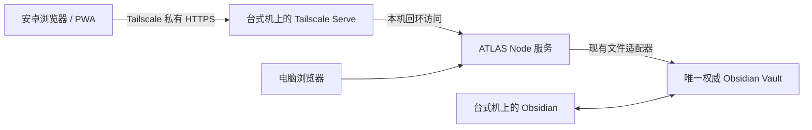

# 安卓访问与低成本多端同步调研

调研日期：2026-10-25。本文为方案研究，尚未部署或修改应用行为。

## 需求与结论

已确认：主要使用安卓，希望手机可以新增业务、与电脑共享数据，并看到现有可视化；手机有网络即可，暂未要求离线编辑。用户有一台几乎一直开机的台式机。

优先方案是 **常开台式机运行 ATLAS + Tailscale 私有 HTTPS 访问 + 手机复用现有网页，随后补齐 PWA 安装体验**。手机和电脑共用一个服务、一份权威 Obsidian Vault，无需先开发双向文件同步或安卓原生应用。

可用性取决于运行服务的设备：如果常开台式机独立于开发电脑，开发电脑关机不影响手机；如果是同一台，关机、休眠、断网或服务退出时手机不可用。若要求这台台式机关机后仍可使用，应把同一套服务部署到云服务器。PWA 不会自动消除这个限制。

## 方案比较

| 方案                                                 | 手机新增与可视化                                 | 台式机关机后                   | 运行成本                                                  | 开发与维护                                 |
| ---------------------------------------------------- | ------------------------------------------------ | ------------------------------ | --------------------------------------------------------- | ------------------------------------------ |
| 常开台式机 + Tailscale + 网页/PWA                    | 改造后复用完整页面                               | 不可用；独立开发电脑关机不影响 | 符合 Tailscale 个人非商业免费套餐条件时无订阅费；另计电费 | 最小，优先推荐                             |
| 云服务器 + 私有 HTTPS + 网页/PWA                     | 与上一方案相同                                   | 可用，仍依赖云主机在线         | 服务器费用；活动、地域、续费价格需核对                    | 额外增加部署、系统维护与 Linux 验证        |
| Syncthing / Remotely Save / Obsidian Sync 只同步文件 | 可同步 Markdown，但不会提供 ATLAS 手机界面和表单 | 手机本地笔记仍可使用           | 免费工具加设备/存储费用，或 Sync 订阅费                   | 单独使用不能满足可视化业务录入             |
| 开发 Obsidian 移动插件 + 一种文件同步工具            | 可实现本地表单、可视化和离线编辑                 | 可用，设备重新连通后同步       | 同步工具决定费用                                          | 需重做移动文件访问与冲突处理，当前投入较大 |

Tailscale 提供网络连接及访问控制，PWA 提供安装与浏览器应用体验；本方案的数据一致性来自共用服务和 Vault。手机通过 API 保存后，记录已经写入主机 Markdown，不需要再把业务数据上传到另一套数据库。

## 推荐结构

- ATLAS 继续监听本机回环地址，由 Serve 提供私有 HTTPS，限制允许访问的账号与设备。
- 手机与电脑复用工作空间、今日、知识、回顾及数据契约。项目、业务线、节点、待办仍只从工作空间新增；实际记录仍只从今日录入。
- 写请求沿用单服务串行写入、稳定 UUID、全文 revision 校验及原子文件发布；同一记录的过期编辑返回冲突，不用最后写入强行覆盖。
- 第一阶段沿用前台 5 秒轮询；补充页面重新可见或网络恢复时刷新。后台浏览器可能暂停轮询，不承诺即时推送。
- 第一阶段不在手机维持另一份可写 Vault。用户若另需在手机 Obsidian 打开笔记，再独立评估文件同步及冲突规则。

## 现有代码证据与必要改造

| 位置                                                     | 现状                                                                   | 所需改造                                                                                              |
| -------------------------------------------------------- | ---------------------------------------------------------------------- | ----------------------------------------------------------------------------------------------------- |
| `apps/local-service/src/server.ts:13,84,276`             | Origin、Host 和监听地址固定为 `127.0.0.1`                              | 保留本机监听，明确配置允许的外部 HTTPS Origin，并核对 Serve 转发的 Host；严格检查来源，不用通配符放开 |
| `apps/local-service/src/server.ts:90`                    | `/api/session` 向访问者返回会话 token                                  | token 是现有本机会话保护，不能当作远程登录；必须先由私有网络访问策略保护整个服务，再返回会话数据      |
| `apps/local-service/src/server.ts:102`                   | 浏览器可切换全局 Vault                                                 | 常开服务预先绑定明确的 Vault；远程手机不需要输入服务器路径或切换全局目录，重启后也应可恢复连接        |
| `apps/local-service/src/native/vault.ts:109,155,249,255` | 服务锁、写入排队、硬链接发布和原子替换已存在                           | 所有网页客户端共用同一个服务，保留现有保护；不要在每台设备再启动独立写入服务                          |
| `apps/web/src/App.tsx:82`                                | 页面可见时每 5 秒读取快照                                              | 小规模先复用，补充恢复前台/重连刷新和明确的失败状态；暂不引入 WebSocket                               |
| `apps/web/src/api.ts:54`                                 | 新记录调用 `crypto.randomUUID()`                                       | 远程地址使用 HTTPS；普通局域网 HTTP 在手机上不具有 localhost 的安全上下文待遇                         |
| `apps/web/src/features/SpaceMenu.tsx:71`                 | 通用编辑依赖右键/键盘上下文菜单                                        | 增加可靠的触屏长按，调用同一个上下文菜单；区分滚动、点击、长按，避免长按误触删除                      |
| `apps/web/src/styles.css`                                | 已有 760px 等窄屏布局与横向节点滚动                                    | 复用后验证窄屏、软键盘、弹窗和长标题；今日保持堆叠，工作空间保留横向业务线                            |
| `apps/local-service/src/native/vault.ts:441`             | Obsidian 链接使用 Windows 绝对文件路径                                 | 远程手机不使用该路径；只有存在手机本地 Vault 副本时，才另行映射本地 Vault 与相对路径                  |
| `apps/local-service/src/server.ts:48,215`                | 部分资源操作在服务器调用系统默认程序                                   | 远程请求不能误在台式机弹出文件；公网 URL 可在手机打开，本地外部文件需明确提示仅主机可用               |
| `apps/web/index.html` 与 `apps/web/src/api.ts`           | 有 viewport/theme-color，没有应用清单和 Service Worker；响应校验契约头 | 后续添加图标、manifest 及明确的前端更新策略；API 不做离线成功响应，旧前端与新服务不兼容时引导刷新     |

PWA 仍是浏览器应用，打包成 APK 也不会让当前 Node 文件服务直接在安卓运行。Obsidian 移动插件不能直接复用 `node:fs`、硬链接及 Windows 路径实现；若未来转向该路线，需要通过 Obsidian Vault API 重写文件访问，并重新验证保存安全。

## 费用与备选

1. **现有台式机优先**：无需购置硬件、云数据库、对象存储或域名。Tailscale 个人套餐标注免费且限非商业用途；企业用途按适用套餐核算。台式机原本就常开时，增加 ATLAS 的边际电耗应实测；如果为了服务专门全天开机，需把整机新增开机时长计入成本。例如平均 50W、每天 24 小时、每度电 0.6 元，30 天约 21.6 元，仅为算例。
2. **确有连续可用需求再上云**：2 核、2GB 内存可作为小规模验证起点，不代表已完成容量测试。可比较阿里云、腾讯云的官方新购与续费页面，区分首年活动价和长期价格；本调研不把抢购价当作保证。公网入口另需可靠认证，不能直接公开当前服务。
3. **手机也要 Obsidian 本地文件时**：选一种同步机制。Syncthing 的原官方 Android 包已于 2024 年停止维护，需确认社区客户端维护状态；Remotely Save 提供 S3/WebDAV 等后端；Obsidian Sync Standard 官网为年付折合 4 美元/月，月付 5 美元/月。这些服务都不会自动生成 ATLAS 的业务表单或视图。
4. **安卓网络适配**：Tailscale 在 Android 使用系统 VPN 能力，可能与已有 VPN 应用冲突；先在用户实际 Wi-Fi 和移动网络验证可达性与延迟。Serve 是私有访问方案，Funnel 是公开暴露服务，两者不能混用。

如果以后增加文件同步，应排除 `.atlas/service.lock` 和 `.atlas-tmp-*` 等运行文件，不同步主机绝对路径配置；业务 Markdown 的冲突副本可能携带同一个 UUID，需要诊断和人工处理。只选一种同步引擎，避免多套工具同时同步相同文件。应用仍最多保留 3 份手动快照，不因“同步”增加自动操作备份或第二事实来源。

云端方案沿用同一份 Markdown 数据模型。现有支持基线是 Windows/NTFS；Linux 或 NAS 部署必须实际验证硬链接、原子替换、目录权限、符号链接防护及重启恢复，不能仅凭 Node 可运行就宣称已支持。开发环境不应直接连接生产 Vault 进行调试。

## 最小实施顺序与验收

1. **先打通私有手机访问**：完成可信入口、精确来源检查、固定 Vault、开机启动与异常退出提示。在样例 Vault 上验证手机使用移动网络访问；测试未授权设备、错误 Origin 与直接 API 访问被拒绝。
2. **补齐手机编辑**：长按复用右键菜单，复用现有新增表单及窄屏视图。手机新增业务线→节点→待办后，电脑能看到；电脑修改后，手机在下一次成功轮询或恢复前台刷新时看到。
3. **验证数据与实际记录**：确认每个实体真实写为 Markdown，保留正文与非 ATLAS 字段；两个客户端同时编辑同一记录时拒绝过期保存；今日录入实际后两端的待办完成状态、时间线与回顾一致。
4. **完善安装与发布**：加入 PWA 安装资产和版本刷新策略。开发代码仍在仓库中维护，构建并发布后手机刷新得到新页面；手机不需要安装开发工具。发布不覆盖 Vault，构建目录和真实 Vault 分开。
5. **验证主机生命周期**：屏幕关闭不影响服务，睡眠/关机明确不可用；服务重启后恢复固定 Vault。若服务锁在崩溃后残留，沿用现有核实进程后处理的规则，不为自启动盲目抢锁。

每批实施后运行受影响的单元/集成测试及构建；跨设备行为增加相关端到端验证，并在真实安卓 Chrome 上验证长按、软键盘、后台恢复和安装。研究阶段只阅读了代码与官方资料，未运行真机联调、跨网络测试或生产部署。

## 主要资料

- [Tailscale 价格与个人套餐适用范围](https://tailscale.com/pricing)
- [Tailscale Serve：私有服务与可信身份头](https://tailscale.com/docs/features/tailscale-serve)
- [Tailscale 与其他 VPN 共存限制](https://tailscale.com/docs/reference/faq/other-vpns)
- [MDN：randomUUID 的安全上下文要求](https://developer.mozilla.org/en-US/docs/Web/API/Crypto/randomUUID)
- [MDN：Service Worker 与 HTTPS](https://developer.mozilla.org/en-US/docs/Web/API/Service_Worker_API)
- [Obsidian Sync 价格](https://obsidian.md/sync)
- [Obsidian 多设备同步与避免混用同步工具](https://obsidian.md/help/sync-notes)
- [Obsidian 移动插件开发限制](https://docs.obsidian.md/Plugins/Getting%20started/Mobile%20development)
- [Syncthing 官方 Android 客户端停止维护公告](https://forum.syncthing.net/t/discontinuing-syncthing-android/23002)
- [Remotely Save 官方项目说明](https://github.com/remotely-save/remotely-save)
- [阿里云官方活动入口，价格以购买及续费页面为准](https://cn.aliyun.com/minisite/goods)
- [腾讯云轻量应用服务器官方价格总览](https://cloud.tencent.com/document/product/1207/73452)
