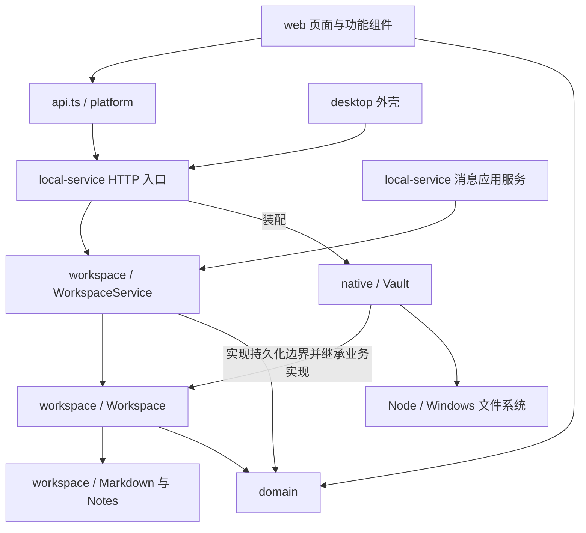

# 仓库分工与跨端复用

当前交付仍是 Windows Electron 桌面版和连接本地服务的网页版。本轮整理提取跨端业务核心，不增加 Android 工程、同步协议、运行时依赖，也不修改四页布局、样式、业务契约或 Markdown 格式。

## 目录地图

| 目录                                  | 负责什么                                                                                             | 不应放入什么                                   |
| ------------------------------------- | ---------------------------------------------------------------------------------------------------- | ---------------------------------------------- |
| `packages/domain/`                    | 七类记录、校验、日期、完成推导、归属查询、标准业务命令与消息契约                                     | Node／Electron、磁盘访问、页面与业务服务       |
| `packages/workspace/`                 | 业务命令编排、保存、完成、改期、移动、升线、删除、Markdown 保真更新与 Notes 内容组织                 | 具体操作系统 API、绝对路径、HTTP、QQ／AI 接入  |
| `apps/web/src/pages/`                 | 工作空间、今日、知识、回顾的页面组合与导航                                                           | 文件读写、另一套完成／改期规则                 |
| `apps/web/src/features/`              | 按功能组织的 React 组件、交互、表单、样式                                                            | Electron 桥接细节和本地服务内部实现            |
| `apps/web/src/components/`            | 通用 UI 控件                                                                                         | 页面编排或平台文件访问                         |
| `apps/web/src/api.ts`                 | 界面现有的记录、Notes、删除等调用入口                                                                | 会话 token 管理与 Electron IPC                 |
| `apps/web/src/platform/`              | 当前 HTTP 会话与契约头处理、受限桌面桥接                                                             | 核心业务规则、另一份工作内容                   |
| `apps/local-service/src/server.ts`    | Windows／源码网页版的启动、HTTP 校验、工作目录切换、服务装配                                         | 被共享核心或 React 页面反向导入                |
| `apps/local-service/src/native/`      | Node 文件适配：索引、严格 UTF-8 读取、路径防护、锁、版本指纹、原子发布、恢复、手动备份和本机资源定位 | 完成、归属、Notes 迁移等跨端工作规则；消息模型 |
| `apps/local-service/src/application/` | 消息收集、去重、识别与确认编排；确认后调用共享业务服务                                               | 第二套工作对象保存与完成规则                   |
| `apps/local-service/src/sync/`        | QQ 读取与同步、来源文件、AI 调用、本机密钥和配置                                                     | 绕过业务服务直接改写工作 Markdown              |
| `apps/desktop/`                       | Electron 窗口、生命周期、目录对话框、QQ 初始化和允许的系统打开行为                                   | 工作对象、Markdown 或 Notes 业务逻辑           |
| `scripts/`                            | 开发样例、架构检查、打包与 QQ 辅助脚本                                                               | 另一个业务实现                                 |
| `tests/`                              | 领域、业务、文件安全、HTTP、浏览器和 Electron 回归                                                   | 用户真实工作目录                               |
| `examples/`                           | 可复制的示例工作目录                                                                                 | 真实数据或密钥                                 |
| `docs/`                               | 产品使用说明、架构和开发说明                                                                         | 运行时配置                                     |

`dist/` 是网页构建产物，`.desktop/` 是桌面构建产物，`releases/` 是发布包；它们不作为源码编辑。`.test-vault/`、`test-results/` 和 `playwright-report/` 是测试产物。应用配置、密钥和用户工作目录不属于源码，不能随跨端代码或交换包一起分发。

## 依赖方向

`packages` 不依赖 `apps`。`domain` 不依赖 `workspace`。共享工作核心不依赖消息契约或平台接入。React 界面不直接导入 `workspace` 或 Node 服务；当前仍经 API 调用业务服务。

## 本轮实际拆分

原来的 `native/vault.ts` 同时处理文件安全和工作业务。现在同一份业务实现位于 `packages/workspace/workspace.ts`，Node `Vault` 继承它，只提供原有持久化操作及本机能力。没有保留旧业务副本或兼容转发文件。

| 文件                                      | 职责                                                                                                             |
| ----------------------------------------- | ---------------------------------------------------------------------------------------------------------------- |
| `packages/workspace/workspace-service.ts` | 原 `application/workspace-service.ts`：标准命令、计划创建与批注入口；接受共享 `Workspace`，不再依赖 Node `Vault` |
| `packages/workspace/workspace.ts`         | 原 Vault 中的工作规则：保存、排序和移动、完成、实际与完成的联合发布、升线、删除与 Notes 迁移                     |
| `packages/workspace/markdown.ts`          | 原 Vault 中的 Markdown 编解码；保留非系统 YAML、注释、自由正文、BOM 与换行约定                                   |
| `packages/workspace/line-notes.ts`        | 原 `native/line-notes.ts`：段落标记、标题、批注去重、迁移和解除结构关联                                          |
| `packages/workspace/file-change.ts`       | 受信服务使用的文件变更与恢复日志结构；不是外部 API，也不是同步协议                                               |
| `packages/workspace/errors.ts`            | 共用错误及 HTTP 状态语义，避免共享业务反向引用 Node 文件模块                                                     |
| `apps/web/src/platform/http.ts`           | 从 `api.ts` 原样分离的 HTTP、token、目录会话与契约校验                                                           |
| `apps/web/src/platform/desktop.ts`        | 桌面桥接的唯一读取位置及其类型；两个原入口仍显示相同按钮和文案                                                   |

共享代码使用标准 `crypto.randomUUID()`，哈希边界允许同步或异步实现。Windows 继续使用原有 Node SHA-256；不改变既有 revision 的计算方式。

## 持久化边界必须保证什么

`Workspace` 声明七个由具体平台提供的操作：

| 操作                                  | 约束                                                                                           |
| ------------------------------------- | ---------------------------------------------------------------------------------------------- |
| `scan()`                              | 返回当前快照、文件列表与诊断；稳定 UUID、重复 ID、关联校验、会话隔离和未完成发布的诊断不能省略 |
| `readSource(relative)`                | 严格读取 UTF-8 原文，保留 BOM／换行，不得把解码错误静默替换成字符                              |
| `contentHash(source)`                 | UTF-8 原文的 SHA-256 十六进制指纹；允许异步，不以更新时间或排序后的对象代替全文版本            |
| `resourceFingerprint(relative)`       | 安全校验目录内路径，文件按原始字节计算 SHA-256，目录返回 null，不跟随越界链接                  |
| `serialized(fn)`                      | 同一工作区的写入排队；关闭、切换和待恢复操作期间拒绝不安全写入                                 |
| `atomic(relative, content, expected)` | null 表示只可新建；否则必须核对原文版本；中断不得破坏旧文件                                    |
| `commitChanges(changes)`              | 先校验完整批次，再按可恢复协议发布；同一业务的对象、Notes 和来源状态不能部分确认               |

路径参数均为工作目录内的相对路径。受信服务可用 `FileChange` 伴随发布来源状态，外部输入仍必须先通过业务契约；不能让扫码、文本或消息直接提交任意文件路径。

跨文件写入保持现有可恢复发布机制，不声称底层文件系统支持多文件瞬时原子替换。恢复日志是短期的未完成发布信息，成功后清除，不是操作历史、自动备份或回收区。手动备份仍最多三份。

`Vault.open/close/safe/recover`、手动备份、Obsidian URL 和本机资源打开仍在 Node 适配器中。手机后续需要自己的目录授权、扫描诊断、可靠写入、恢复和资源打开实现；这次没有声称这些能力已支持 Android。

## 后续手机和 Windows 怎样共同演化

1. 业务行为先改 `domain` 和 `workspace`，两端共用规则，不为 Android 复制一份业务服务。
2. 手机若继续用同一套 React，响应式组合、触摸交互仍在现有 `pages/features/components` 中维护；平台调用从 `platform` 接入。此次仅分离当前 HTTP 实现，尚未实现可切换的安卓传输桥。
3. Android 工程实际开始时再增加平台适配，实现上述持久化约束，并复用 `WorkspaceService`。不复制 Electron、QQ 读取脚本、Windows 绝对路径或进程锁格式。
4. 扫码／文本／文件交换届时定义独立、版本化的交换协议，校验后调用共享业务服务。当前 `Snapshot.vaultId` 是目录连接会话标识，不能直接用作跨设备工作区身份；`FileChange` 和 pending 日志也不能当作可直接导入的交换包。
5. 继续在一个仓库和 PR 中维护共享规则与平台适配；以后在同一发布标签下分别构建 Windows 和 APK。APK 签名和移动测试在有实际工程时再加入。

## 验证与约束

`npm run check:architecture` 现在检查全部 `apps` 和 `packages`，包括静态导入、导出、字面量动态导入和 require；共享核心禁止 Node／Electron、反向应用依赖和消息接入依赖，UI 的 Electron 访问集中在平台入口。检查脚本内置允许／拒绝用例，防止规则失效。它不是运行时代码沙箱，不解析计算生成的动态模块名。

`tests/portable-workspace.test.ts` 将共享业务打包为浏览器代码，在仅提供 Web Crypto 和编码 API、没有 Node／DOM 的上下文中运行；另用异步哈希的内存适配器验证 Notes、改期、升线、删除、版本冲突及伴随状态冲突。内存适配器只用于测试，不代表安卓文件安全已经验收。

完成整理后运行 `npm run check`，并构建桌面包、运行 `npm run test:desktop` 验证 Electron 的真实目录选择、四页、保存、QQ 入口和退出恢复。文件安全测试必须在支持 NTFS 硬链接、Junction 与原子重命名的环境运行，不为通过沙箱测试而降低安全断言。
