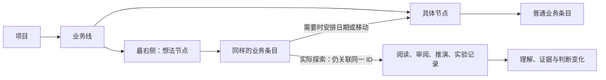

# 统一业务动线：手机运行、想法节点与认知工作记录

研究日期：2026-10-25。本文根据当前仓库、官方技术文档和研究论文形成建议，未实现功能、修改 AGENTS.md 或改写真实 Vault。

## 统一原则与最终建议

用户补充的约束是：形成统一的业务管理过程，用户只需熟悉一套动线；例如每条业务线最右侧自动有一个 idea 节点，而不是把想法拆成新的数据类型或独立灵感系统。

因此，最终建议是：**想法节点 + 普通待办 + 关联同一条目的实际过程记录**。不新增 idea、反思、决策等顶层实体，不新增独立灵感库或第二套编辑器。

统一业务过程：

> 选业务线 → 记一件事 → 实际探索/推进 → 留下理解与判断变化 → 决定继续、安排、完成或不继续 → 回顾同一条业务脉络。

四层项目结构仍存在，日常录入从当前上下文带入；用户不必在“笔记 / 灵感 / 待办 / 思考”之间先选一种类型。工作空间仍是计划与条目管理入口，今日仍是实际录入入口。统一业务过程不等于把计划和实际混在一个弹窗。

此前研究中“用独立灵感资源承接所有想法”的方案，在用户明确这一约束后不再推荐。已有知识资源作为附件和材料，服务于业务过程，不成为另一套工作管理入口。

## 1. 以后搬到云服务器是否还能正常使用

可以。当前 React 页面、业务契约、可视化和 Markdown 数据都可继续使用。常开台式机与云端单用户部署的主体结构相同：浏览器 → HTTP 服务 → 一份权威数据目录。Tailscale 负责连接，不应进入业务数据模型。

| 能力 | 云端沿用情况 | 条件 |
| --- | --- | --- |
| 新增业务、节点、条目和实际记录 | 可沿用 | 同源 HTTPS、可靠访问控制、固定 Vault |
| 手机工作空间、今日、回顾可视化 | 可沿用 | 完成触屏、软键盘和窄屏验证 |
| 想法节点、自动匹配、标签、反思过程 | 不依赖主机位置 | 共享业务规则，不依赖 Windows 路径 |
| Markdown 与稳定 ID | 保持格式 | 受控复制到新主机、校验后切换 |
| 电脑绝对路径与系统默认程序 | 不能直接搬 | 云服务器无法打开用户电脑本地文件 |
| 在 Obsidian 中打开 | 依赖客户端是否有对应文件 | 手机没有副本时应使用应用自身正文流程 |

搬迁时停旧服务，复制并核验业务文件，再启动新服务；不把活动的 service.lock 当业务文件复制，不让两份 Vault 同时成为可写主库。服务器地址、凭据和 Vault 根路径属于部署配置。

当前实现主要在 Windows/NTFS 验证，依赖硬链接发布、原子替换和路径安全检查。Linux 云部署要实测权限、持久卷、文件系统行为及重启恢复。现有 /api/session 返回的 token 用于本机会话保护，不等于公网登录能力。

只要手机和电脑都访问同一服务，就不需要应用级双向同步；如果以后两端各自离线修改再合并，才需要设计版本基线、删除冲突、重复请求和跨记录一致性，不能只换一个 API 地址。

## 2. 完全搬到安卓手机，不同步也不依赖 Obsidian

这里把“手机上改动”理解为手机独立操作全部业务数据；源码开发和安装包构建仍可以在电脑完成。

| 路线 | 独立离线使用 | 现有代码复用 | 评价 |
| --- | --- | --- | --- |
| 网页/PWA 调电脑接口 | 不可 | 最高 | 仍依赖电脑在线 |
| 完整离线 PWA + IndexedDB/OPFS | 可以 | 页面、领域逻辑可复用，存储重做 | 适合原型；需处理浏览器持久性、清理和导出 |
| React + Capacitor + 手机本地 Markdown | 可以 | 页面和领域逻辑可复用，文件服务重做 | 保留现有数据原则时优先 |
| React + Capacitor + SQLite | 可以 | 页面、领域逻辑可复用，持久化重做 | 若明确放弃 Markdown 权威存储，再比较 |
| Kotlin/Compose 或 Flutter 重写 | 可以 | 主要界面需重写 | 当前投入较大，没有充分必要性 |

Capacitor 能把现有 Web 构建产物放入安卓应用，通过插件调用原生能力；它不会自动把 Node 文件服务装进手机。[Capacitor 官方说明](https://capacitorjs.com/docs/getting-started)

推荐结构：

主要改造：

1. 复用 packages/domain、表单、工作空间、今日和回顾。将 vault.ts 中不依赖 Node 的 Markdown/YAML 解析和更新逻辑提取出来，保留正文、非 ATLAS 字段和稳定 ID。
2. 将 api.ts 的 HTTP 操作替换为本地调用。手机不启动 Node HTTP 服务，不要求维持一个常驻后台进程。
3. 用原生文件桥接实现扫描、严格 UTF-8 读写、串行保存、revision 校验、安全发布、删除、手动快照及导出。Capacitor Filesystem 提供读写和 rename，但其文档没有承诺桌面版现有的完整安全提交语义，需实测，必要时补小段原生安全写入实现。[Filesystem 文档](https://capacitorjs.com/docs/apis/filesystem)
4. 首版可以使用应用私有持久目录，确保应用内唯一写入者；不能使用缓存目录。提供用户主动导出到共享存储、恢复和换机操作，应用内最多 3 份手动快照。
5. 关联外部文件使用系统选择器和 URI 授权，不再使用 Windows 路径。已有文件不自动移动或改写。知识页保持清单与打开，独立正文流程负责编辑。
6. 验证长按菜单、返回键、软键盘、字体放大、进程被杀、空间不足及签名升级。

不使用 Obsidian 同步，不等于必须放弃 Markdown。应用可以自己维护本地 Markdown 目录，完全不要求安装 Obsidian。若选 SQLite，应明确将数据库变成唯一权威来源、Markdown 仅用于导出，并修订现有原则；不维护两份可写业务事实。Android 的 Room 是本地 SQLite 的一条官方路线，但在 Capacitor 中仍需桥接。[Android Room](https://developer.android.com/training/data-storage/room)

卸载应用或清除应用数据会删除私有目录；主动导出到共享文档的文件可以保留。SAF 可以授权访问用户选择的目录，但 URI 权限和不同文档提供方的写入能力需要验证，不能假定与本地 NTFS 相同。[应用私有存储](https://developer.android.com/training/data-storage/app-specific)、[共享文档与系统选择器](https://developer.android.com/training/data-storage/shared/documents-files)

浏览器离线数据受配额、持久性授权和清理策略影响；Service Worker 只能解决一部分离线启动问题，不能独自保证业务数据可靠。[MDN 存储机制](https://developer.mozilla.org/en-US/docs/Web/API/Storage_API/Storage_quotas_and_eviction_criteria)

独立手机版以后仍可复用模型和页面接云端，但已有本地资料需要显式导入和核验；同时保留手机本地与云端可写，就必须实施同步。两条运行路线可以共享业务规则，不应在第一版同时建设所有存储和同步组合。

## 3. 自动匹配文字开头的业务归属

建议优先做，本地规则就能解决大部分明确标题和路径的归属问题，不要求云 AI 或按次付费。

输入例如：

> 【卫星项目 / 姿控算法 / 卸载方案审阅 / 核对坐标变换】读了 AI 生成的实现，发现惯性系转换的假设不成立。

界面自动显示候选归属路径，保留原始输入，用户正常保存即可。选择较短路径也成立：

- 【卫星项目 / 姿控算法】研究磁矩映射：匹配到业务线，不编造节点或待办。
- 【核对坐标变换】继续推导：在当前上下文中唯一时推导完整祖先。
- 【实验记录】核对日志：存在同名节点时展示完整路径候选，不自动猜中一个。

最小规则：

1. 只解析开头的明确路径或字段；自然语言前缀也可尝试，但只作建议。不把正文所有名词、时刻、URL 中的分隔符都当结构。
2. Unicode NFKC、空白和拉丁大小写归一。先精确，再前缀/包含，最后处理小范围错字。拼音、简称、同义词不是编辑距离天然能够解决的问题。
3. 按项目→业务线→节点→待办逐层限制候选；省略上级时，只有唯一叶子才能反推。不拼出跨项目的非法组合。
4. 唯一精确结果可预选并展示；模糊、短词或候选接近时提供少量带完整路径的选项。检索分数不是正确概率，不拿未经验证的阈值承诺准确率。
5. 用户手动选择后优先使用手选结果，继续改正文不偷偷重绑。匹配本身不创建、改名、完成或搬移记录。
6. 工作空间记新条目：只匹配到业务线时，默认落到该线最右侧的想法节点；不要求再选类型。今日录实际：只匹配到业务线时可先关联业务线或保留未关联，不偷偷创建计划条目。
7. 已有条目可直接关联实际，无论它是否有截止日期；完成项和归档项按使用场景处理，不把归档对象作为新工作默认候选。

第一版可先不加库，验证明确匹配和歧义处理。真实样本表明错字处理不够，再考虑 Fuse.js；层级关系与误匹配控制仍由应用完成。[Fuse.js 原理](https://www.fusejs.io/fuzzy-search.html)

同一匹配器可用于工作空间的多行导入预览，每行展示上级、拟新建条目和歧义后提交。必须区分“关联已有对象”与“新建对象”，定义重复提交、部分失败与重试；当前多文件写入不是整批事务。

## 4. 节点标签与实际活动

当前节点已有固定 kind（关键节点、开会、讨论、修改、审阅），但没有自由多标签；资源的单个 tag 是知识目录归类，也不是节点标签。

建议节点增加可选 tags[]，提供“会议、讨论、个人专注、实验、审阅”等常用词并允许直接输入。用户新增仍优先只填标题，标签放可选设置，支持筛选，不创建新的标签实体或文件夹。

标签使用中性文字展示；节点圆点的绿、黄绿、黄、橙、红仍只表示重要性。标签不改变日期排序，不制造时长，也不因标签改动移动 Markdown。

需要区分计划与实际：“会议、讨论”可以描述计划节点，“个人专注”更多描述工作方式；统计实际花了多少时间，必须依据实际记录，不能把节点标签当成已发生的证据。标签可以作为录实际时的建议，但不静默复制为事实。

现有 kind 与新 tags 有重叠，小批次先加自由标签与明确的显示规则，避免让用户填两遍同义分类；不顺便自动改写真实 Vault 的旧 kind。知识目录 tag 与节点 tags 的职责保持不同。

## 5. 每条业务线最右侧的想法节点

### 采用用户提出的结构

每条业务线自动有一个无日期、无截止时刻的“想法”节点；节点内仍是普通待办。用户在这里记一句话，不需要选择灵感、笔记或待办类型，也不必先承诺执行。

这里的“想法节点”是同一工作结构里的收集位置，不是第八类数据，不独立建立灵感库。“待办”在用户心中可以更宽泛地理解为业务条目，不要求每条都立即执行或完成。

### 普通无日期待办与想法的区别

无期限不等于未承诺。已经决定做、只是没设期限的条目，仍是准备执行的工作；“也许有用”的方向暂时只是待整理。两者可用已有状态表达，不需要两种数据类型：

| 当前情况 | 记录方式 | 今日与回顾 |
| --- | --- | --- |
| 突然想到一个方向 | 想法节点下的条目，默认待整理，无日期 | 不占今日计划，可随时关联实际探索 |
| 已决定做但没期限 | 同一条目改为可开始，日期可空 | 可从实际关联列表选择，不伪造日期 |
| 目前正在验证 | 同一条目关联若干实际记录；是否显示进行中由明确动作决定 | 展示探索投入，不要求完成 |
| 已决定具体行动 | 给同一条目设日期，或移动到真实节点 | 日期匹配时进入今日；ID、正文、记录保留 |
| 验证后不继续 | 记录结论，按条目目标选择完成或归档 | 保留验证过程，不当成白做 |

例如“验证 A 假设是否成立”，反证成功可以是该条目完成；“采用 A 方案实现功能”被证据否定，则可能是不继续。不要把“推翻假设”写成统一的任务失败状态。

GTD 的 Someday/Maybe 把“尚未承诺”与日期分开处理，值得借鉴的是这个区分；在 ATLAS 中可用同一条目的状态实现，无需复制一份列表或新类型。[GTD 原始说明](https://gettingthingsdone.com/2010/10/what-goes-on-a-someday-maybe-list/)

### 保持一套操作

- 收集：工作空间中选当前业务线，按“记一件事”；默认到想法节点。标题足够保存，可选设置折叠。
- 推进：在条目上“记录推进”，先导航今日，再打开唯一实际录入流程，自动关联该条目。
- 安排：右键/手机长按使用现有条目菜单，设置日期、移动到具体节点或拆出下一步；不重建原条目。
- 回看：条目详情展示其已有实际记录和判断变化，数据从同一批实际记录查询；继续推进仍跳到今日。
- 实际中想到新方向：先把想法写在当前实际记录里；需要独立跟踪时再跳工作空间，预填到同一业务线想法节点。不能在今日暗中新增计划。

任何条目都能记录审阅、推演和反思，不把这些能力限定在想法节点。条目移出想法节点以后，操作方式和过程记录都保持相同。

### 必须处理的边界

1. 该节点是无日期的收集锚点，不在今日计划线上占一个伪造时刻，也不设置开始/结束时间。
2. 使用明确的内部角色识别，不通过标题等于“idea”或标签猜测。可以复用 milestone.kind 扩展一个系统用途值，实体 type 仍是 milestone；用户无需管理这个内部值。
3. 每条业务线至多一个；新建业务线时创建，失败要提示并允许安全重试，不重复创建。删除它不能造成永久失去收集位置，需在具体实现时明确保护规则。
4. 固定在最右是用户新增的排序要求。不能只靠“它最早创建”，因为已有业务线和旧无日期节点会破坏这一假设；要显式排在普通有日期/无日期节点之后，普通节点内部继续沿用原排序。
5. 给单个条目设日期不需要先移动；想法节点本身不设截止日期。待整理条目不自动进入计划、催办或重要性推荐；需要安排时由用户明确转为可执行状态。
6. 不把“移入/移出想法节点”等同于已完成、已推翻或已理解；位置表达组织方式，实际记录表达做过什么。
7. 开始探索不自动勾完成；取消原想法不删除实际记录。删除保护要检查实际引用。
8. 用户尚未知道属于哪条业务线时，不能随便猜；可在工作空间停留草稿并建议归属。若真实使用需要跨业务线收集，再明确设计工作空间内的统一待整理位置，不先添加全局“杂项项目”。
9. 现有 Vault 读取不应静默批量写入。新业务线按新规则创建；已有业务线补想法节点，应由明确的工作空间操作触发并展示结果，而不是在打开页面时自动改写。

## 6. 把 idea 探索和 AI 反思融合为同一条业务过程

### 不新增反思类型，增强普通实际记录

当前 actual 已允许只填开始、结束、事件；推进与完成也分开保存。但只能通过待办推导归属，回顾主要突出完成量，缺少对理解与判断的呈现。

建议所有条目的实际录入都采用同一张表单：

> 开始/结束时间 → 这段做了什么 → 关联当前条目 → 可选的“理解与判断变化”。

前三项要求沿用现状：必填仍只有开始、结束、具体事件，关联仍可选。增加内容都留在 actual 中：

- 可选一个主要活动：阅读理解、审阅验证、推演、实验、讨论、实现，用于汇总，未填为未分类。
- 可选反思：“原先怎么看 / 现在怎么看 / 依据或疑问”。可以只写一句，可以写“暂未形成结论”。
- 可选判断变化：确认、修正、推翻、出现新问题、暂未形成结论。它描述这次记录，不改任务完成状态。
- 可选材料引用：AI 输出、PR、代码版本或文档；复用资源引用作为附件，不建立另一套业务对象。

“随机”是想法来源，“推进”是工作关系，“推翻”是认识变化，不能放进同一个必选类型栏。第一版甚至可以先只提供一段可选反思文字，在真实样本足够后再细分。

### 同一个条目的完整例子

条目：姿控算法 → 想法 → “怀疑卸载效果差与坐标变换有关”。

| 时间 | 实际做了什么 | 理解与变化 | 条目是否完成 |
| --- | --- | --- | --- |
| 周一 10:00–10:40 | 阅读 AI 给出的卸载实现 | 原以为只是增益；现在怀疑坐标变换 | 不完成 |
| 周二 14:00–14:35 | 手推旋转关系，检查边界工况 | 找到反例，推翻原旋转方向的假设 | 不必完成 |
| 周三 09:00–09:30 | 对照遥测验证 | 新假设得到部分支持，还需排除时间对齐 | 不完成 |
| 后续安排 | 给原条目设日期或移入“卸载验证”节点 | 继续引用原来三段记录 | 身份和过程保持 |

每一段都是普通 actual，关联同一个待办 ID。条目详情的“过程”按时间展示它们，回顾按周展示，今日按当天展示；三处查询同一份数据，不各存一份日志。

一个条目有多段实际记录，时长只按 actual 的时间范围计一次。关联多个条目不复制时间，跨项目不擅自均摊。

actual.history 是编辑修订，不是认知演进。后来改变观点应新增真实发生的实际记录、说明原判断和新证据，而不是通过改旧记录让历史看起来一直正确。重要结论可在条目正文中总结，仍是同一条目的内容，不另起独立灵感记录。

这类保留旧判断及替代理由的处理可以借鉴 ADR，但不要求每次阅读都写正式决策报告。[ADR 原始说明](https://cognitect.com/blog/2011/11/15/documenting-architecture-decisions)

### 如何鼓励“没有直接交付”的工作

- 今日把审阅、理解和推演与实现同等显示，不因为没有完成勾选而隐藏投入。
- 条目过程和回顾直接呈现“做过什么、发现什么、接下来还不确定什么”，不只呈现完成数。
- 提供可选的“写下自己的理解/疑问”，先保留用户自己的表达，再按需请求 AI 辅助整理；不先让 AI 写出标准反思供用户照抄。
- 不强制每段工作填反思，不把时长、字数、推翻次数或连续打卡当成理解质量分。
- “经验证后接受 AI 的结论”与“提出反证拒绝 AI 的结论”都可以有价值。避免让用户为了证明思考而制造反对意见。
- 允许没有新判断。重复核验、熟悉代码、消化公式都是真实投入，系统可记录，但不能仅凭记录就证明有效理解。

CHI 2025 对 319 位知识工作者、936 个使用案例的研究发现，对生成式 AI 的信心与较少的自报批判思考相关，并指出工作更多转向验证、整合和把控任务。这是问卷关联证据，不能推导“AI 必然损害能力”，也不能证明某一种提示一定有效；对本产品的启发是支持独立验证，而不是替用户完成理解。[研究原文](https://www.microsoft.com/en-us/research/publication/the-impact-of-generative-ai-on-critical-thinking-self-reported-reductions-in-cognitive-effort-and-confidence-effects-from-a-survey-of-knowledge-workers/)

SPACE 框架指出开发生产力不能由单一活动指标衡量，因此不宜用提交数或完成数统领整个回顾，更不应直接发明思考质量分。[SPACE 原始论文](https://www.microsoft.com/en-us/research/publication/the-space-of-developer-productivity-theres-more-to-it-than-you-think/)

## 7. GitHub 作为同一业务条目的证据来源

先做链接，暂不建设完整账号同步：在条目或实际记录中附 PR、issue、commit、review comment 或代码永久链接。它们复用已有 URL 资源，不成为另一套业务入口。

代码证据优先使用 commit SHA 固定版本，并记录行范围；PR 会更新，应知道当时看的是哪个 head SHA。打开过旧版本不表示新版本也已审阅。GitHub 官方支持指向特定文件版本和代码行的永久链接。[永久代码链接](https://docs.github.com/en/get-started/writing-on-github/working-with-advanced-formatting/creating-a-permanent-link-to-a-code-snippet)

后续只有手动链接确实不够时，再做用户触发的只读导入：读取选定仓库的标题、diff 和审阅元数据，沿用同一条目的材料关联；令牌不写进 Vault 正文。Android 可用 Keystore 中的密钥保护加密保存的令牌，Keystore 本身不用于直接存任意长文本。[GitHub 认证](https://docs.github.com/en/rest/authentication)、[API 使用建议](https://docs.github.com/en/rest/using-the-rest-api/best-practices-for-using-the-rest-api)、[Android Keystore](https://developer.android.com/privacy-and-security/keystore)

不通过浏览时间自动计工时，不用 Approved 状态证明理解，不将私人反思自动发成 GitHub 评论。对外发布评论、批准或创建 issue 是单独的写操作，默认不做。GitHub 官方也要求 AI 审阅补充人工验证；ATLAS 应保留人验证了什么和为何接受/拒绝，而不是再造自动审阅器。[GitHub 审阅说明](https://docs.github.com/en/copilot/concepts/agent-capabilities/agent-powered-workflows-and-operations/code-review)

## 8. 最小改造范围与顺序

| 批次 | 交付 | 关键验证 |
| --- | --- | --- |
| A | 节点标签；每条业务线唯一的最右侧想法节点；沿用普通待办与待整理状态 | 排序例外、单例创建与重试、待整理不挤入今日，真实 Markdown 落盘 |
| B | 同一实际表单增加可选反思与材料；条目详情展示关联过程；改进回顾 | 三项必填不增加、推进不等于完成、重复关联不重复计时、删除引用保护 |
| C | 本地文字归属建议；工作空间批量输入预览 | 同名消歧、短词误匹配、手选优先、无匹配保留原文、部分失败 |
| D | 选择常开主机私有访问，或安卓本地运行 | 前者验证 HTTPS 与真实网络；后者验证离线、安全写入、导出恢复和升级 |
| E | 确有需要再搬云端或增加 GitHub 只读导入 | 一份权威数据、权限范围、版本对应和运行恢复 |

当前模型需要的新增内容主要在 milestone 的系统用途和 tags、actual 的可选反思/活动/材料引用，以及查询与呈现。项目→业务线→节点→待办继续只存直接上级 ID；条目移动保留原 ID 和实际关联，不把想法复制成一个新待办。

按现有指引，“想法节点固定最右”是对普通节点排序的明确例外，“待整理不进入日计划”需要补充筛选规则；建议在真正实施相应批次时同步修订规则和测试，不默默修改用户真实资料。

若要支持只匹配到业务线的实际归属，可以给 actual 增加一个可选业务线上下文，仅在没有待办关联时使用；有待办则继续沿关系推导，避免存两份父级。也可以第一版保留未归属实际，不为此自动制造占位待办。

测试围绕真实风险：结构化字段与正文保留、并发 revision、想法节点单例、无日期与日期筛选、条目移动后实际记录连续、文本歧义和统计重复。真机检验长按、软键盘、后台恢复与保存失败。产品验证看是否更容易记录真实思考、能否找回原判断和依据，以及误归属是否减少，不只看记录数量增加。

本轮尚未做 Capacitor 原型、Android 文件安全试验、跨网络联调或匹配准确率基准；工程规模仅为相对比较，不承诺工期和准确率。
